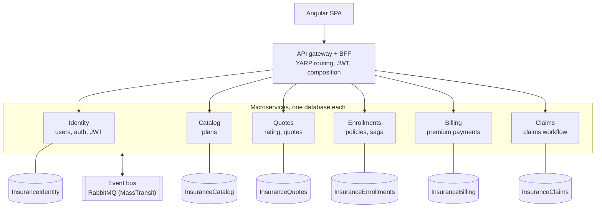
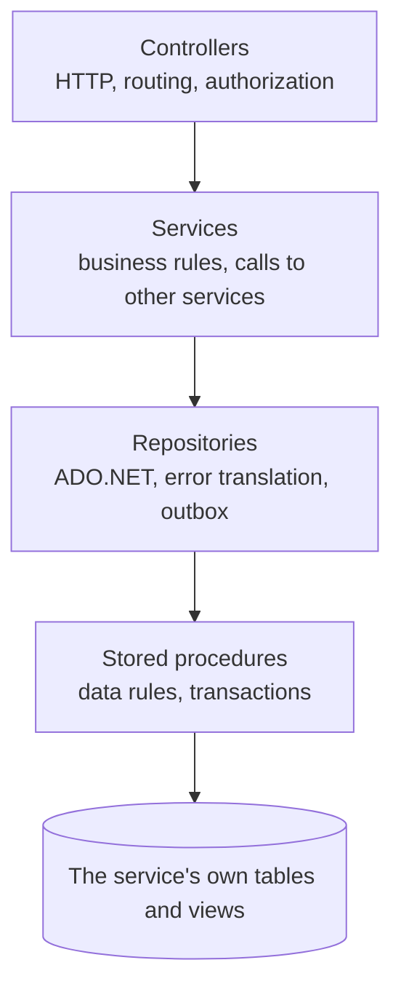

# Online Insurance Management System

A full-stack insurance platform. Customers get **personalized quotes**, enroll in policies, pay monthly premiums and file claims. Administrators manage the plan catalog, review claims and manage customer accounts.


> **Live demo:** [Project Website](https://projectdeploy-ewbahrbra0abcuam.westus3-01.azurewebsites.net/)
> *(Hosted on a development-tier Azure plan, so the first request after a quiet period may take a few seconds.)*
> Demo logins are listed under [Demo accounts](#demo-accounts).

## Screenshots

| Personalized quote | Customer policies | Claims review (admin) |
|---|---|---|
|  |  |  |

| Premium schedule | Overdue alert | Customer management (admin) |
|---|---|---|
|  |  |  |

## Table of contents

- [Overview](#overview)
- [Features](#features)
- [Tech stack](#tech-stack)
- [Architecture at a glance](#architecture-at-a-glance)
- [Key business rules](#key-business-rules)
- [Getting started](#getting-started)
- [Demo accounts](#demo-accounts)
- [Configuration reference](#configuration-reference)
- [API overview](#api-overview)
- [Testing](#testing)
- [Project structure](#project-structure)
- [Deploying to Azure](#deploying-to-azure)
- [Known limitations](#known-limitations)
- [Roadmap](#roadmap)
- [Documentation](#documentation)

## Overview

The application simulates the core operations of an insurer:

1. An admin publishes **plans** (Health, Auto, Life, Home, Travel).
2. A customer answers a short, plan-specific questionnaire. The server **rates** the applicant and issues a **quote**: a price with a full breakdown of how it was calculated, or an underwriting decline.
3. The customer **enrolls** from the quote. A **saga** across three services reserves the quote, creates the policy and its monthly **premium schedule**, and confirms the quote.
4. The customer pays installments, and can **file claims** against active, paid-up policies.
5. Admins move claims through a **review workflow**, and manage customer access.

The backend is a set of **microservices**: six ASP.NET Core services, each with its own database, behind an **API gateway + BFF**. Services call each other over HTTP for queries and exchange **events over RabbitMQ** for everything that changes state in another service. The Angular frontend talks only to the gateway. Inside each service, data access uses **ADO.NET with parameterized stored procedures**.

## Features

### Customers
- Register, sign in and sign out. Passwords are hashed with BCrypt and sessions use JWTs.
- Browse the plan catalog and filter by type.
- **Get a personalized quote:** the API supplies the questions for each plan type, and the form is built dynamically from them. The result shows the base rate, every rating factor, the monthly price, the total over the term and the quote's expiry date.
- Enroll from a quote with a chosen start date, and cancel a policy.
- **Pay premiums** in order from a payment schedule, with paid, pending and overdue states.
- **Simulated checkout:** pay by credit/debit card, PayPal, Apple Pay, Google Pay or Venmo. Card numbers are validated (brand, checksum, expiry, security code) and turned into a token in the browser; the server never sees them. Name and billing address are filled in from sign-up, cards can be saved for later, and every attempt gets a printable receipt.
- **Payment history:** every attempt on a policy, including declined ones, with the reason the customer was given.
- **Payment alerts:** a "payment due soon" or "payment overdue" badge on each policy.
- **File claims** with incident date, amount and description. Eligibility is validated against the policy.
- Track claims through the review workflow and read the reviewer's notes.

### Administrators
- Create, edit and deactivate plans. Deactivated plans disappear for customers but remain on existing policies.
- **Claims review queue** with a status filter. Buttons show only the legal next step, and a rejection requires a reason.
- **Customer management:** search, filter by status, see active-policy and claim counts, and deactivate or reactivate accounts (takes effect on the customer's next request).
- **Payment log:** every payment attempt from every customer, filterable by status, with amounts collected, declines and refunds.

### Platform
- Role-based authorization (`Customer`, `Admin`), with ownership checks on every record.
- Centralized error handling that returns consistent RFC 7807 `ProblemDetails` responses.
- Swagger/OpenAPI with JWT support for testing the API.
- Seed data for a 20-plan catalog and a set of demo customers with realistic histories.
- **Microservices:** six independently deployable services with a database each, an API gateway (YARP) with BFF composition, an event bus (MassTransit on RabbitMQ), an orchestrated saga with compensation, a transactional outbox, idempotent consumers, and graceful degradation when a service is down.
- `docker compose up` starts the whole system: SQL Server, RabbitMQ, six services and the gateway.

## Tech stack

| Layer | Technology |
|---|---|
| Frontend | Angular (standalone components, signals, lazy-loaded routes), TypeScript, HTML5, CSS3, RxJS |
| Services | C#, ASP.NET Core Web API (one per service), RESTful design, Swagger/OpenAPI (Swashbuckle) |
| API gateway | YARP reverse proxy, JWT validation, BFF composition endpoints |
| Messaging | RabbitMQ through MassTransit (retries, faults), transactional outbox |
| Data access | ADO.NET (`Microsoft.Data.SqlClient`), parameterized stored procedures, views, LINQ in the service layer |
| Database | SQL Server / Azure SQL Database: **one database per service**, created and migrated by the service at startup |
| Security | JWT bearer authentication (validated by the gateway and every service), BCrypt, role-based authorization |
| Patterns | Microservices, database per service, API gateway + BFF, saga (orchestration), transactional outbox, idempotent consumer, dependency injection, repository, strategy (rating engine), DTOs |
| Testing | xUnit with hand-written fakes, architecture tests for service boundaries |
| Containers | Docker, Docker Compose |
| Tooling | Visual Studio Code, Git and GitHub |

## Architecture at a glance



| Service | Owns | Talks to |
|---|---|---|
| **Identity** | Users, sign-in, JWT issuing | Nobody (others call it) |
| **Catalog** | Plans | Nobody (others call it) |
| **Quotes** (Quotes) | Rating engine, quotes | Catalog (HTTP). Consumes `EnrollmentActivated`, `EnrollmentFailed` |
| **Enrollments** (Enrollments) | Policies, **the enrollment saga** | Quotes, Catalog, Billing (HTTP). Publishes `EnrollmentRequested`, `EnrollmentActivated`, `EnrollmentFailed`, `EnrollmentCancelled` through an outbox |
| **Billing** | Premium schedules, payments | Enrollments (HTTP). Consumes `EnrollmentRequested`, `EnrollmentCancelled`, `EnrollmentFailed`; publishes `PremiumScheduleCreated` |
| **Claims** (Claims) | Claims, review workflow | Enrollments, Billing, Catalog, Identity (HTTP) |
| **Gateway + BFF** | Nothing | Routes `/api/*`; checks that the caller's account is active (Identity); composes the admin customer list (Identity + Enrollments + Claims) |

**Rules that keep them independent:** a service never reads another service's database, and never references another service's code, only its `*.Contracts` package (events, internal API shapes and a typed HTTP client). `Insurance.Architecture.Tests` fails the build if either rule is broken. Queries go over HTTP; anything that changes another service's data goes through an event.

Inside each service, a request flows one way:



See [docs/ARCHITECTURE.md](docs/ARCHITECTURE.md) for the enrollment saga, the outbox, sequence diagrams, the data model of each service, the claim workflow, the rating engine, the security model and the complete error-number registry.

## Key business rules

| Area | Rule |
|---|---|
| Quotes | Priced on the server from the customer's answers. The client never sends a price. Valid for 30 days and usable once. |
| Rating | `premium = base rate x every factor`, rounded to cents, minimum $1.00. Some answers trigger an underwriting decline. |
| Enrollment | Start date from yesterday (time-zone slack) to 90 days ahead. One active enrollment per plan per customer. The premium is copied from the quote, so later plan price changes never alter existing policies. |
| Payments | Installments must be paid **in order**. An unpaid installment becomes **Overdue** more than **5 days** past its due date. A payment alert shows when the next due date is within **7 days**. |
| Claims | Active policy only. The incident must fall inside the coverage period and not be in the future. No overdue premiums. The amount cannot exceed the remaining coverage (policy coverage minus approved and paid claims). |
| Claim workflow | Submitted, Under review, then Approved or Rejected, then (approved only) Paid. A rejection needs a reason. Concurrent edits are detected. |
| Accounts | Deactivated accounts cannot sign in and existing tokens stop working. Admin accounts cannot be deactivated from the UI. |

## Getting started

### Prerequisites

- [Docker](https://docs.docker.com/get-docker/) with Docker Compose (for the services, SQL Server and RabbitMQ)
- [.NET SDK](https://dotnet.microsoft.com/download) (current LTS), to build, test or run a service outside Docker
- [Node.js](https://nodejs.org/) 20 or later, and the Angular CLI (`npm install -g @angular/cli`)
- Recommended VS Code extensions: C# Dev Kit, SQL Server (mssql), Angular Language Service

### 1. Clone

```bash
git clone https://github.com/<your-username>/insurance-management-system.git
cd insurance-management-system
```

### 2. Start the backend

```bash
cp deploy/.env.example deploy/.env
```

Edit `deploy/.env` to set your own `SA_PASSWORD` and `JWT_KEY`, then:

```bash
docker compose -f deploy/docker-compose.yml up --build
```

This starts SQL Server, RabbitMQ, the six services and the gateway. Each service creates its own database on first start (its scripts are in `src/Services/<Service>/Insurance.<Service>/Database/`), and the Catalog service seeds the 20 plans. The API is at <http://localhost:5080/api>, and the RabbitMQ dashboard at <http://localhost:15672> (guest / guest) shows the queues and the events flowing.

### 3. Run the frontend

```bash
cd insurance-web
npm install
ng serve
```

Open <http://localhost:4200>. The API address is set in `src/environments/environment.development.ts` (`http://localhost:5080/api`, the gateway).

### 4. Create the admin account

There is intentionally no public admin sign-up. Register a normal account in the app, then promote it in the Identity service's database:

```bash
docker compose -f deploy/docker-compose.yml exec sqlserver /opt/mssql-tools18/bin/sqlcmd -C -S localhost -U sa -P "<your SA_PASSWORD>" -Q "UPDATE InsuranceIdentity.accounts.Users SET Role = 'Admin' WHERE Email = 'you@example.com'"
```

Sign in again so the new role is placed in your token.

### 5. Optional: load the demo data

```bash
docker compose -f deploy/docker-compose.yml exec sqlserver /opt/mssql-tools18/bin/sqlcmd -C -S localhost -U sa -P "<your SA_PASSWORD>" -i /seed/demo-data.sql
```

`deploy/seed/remove-demo-data.sql` removes it again. These dev-only scripts write to all six databases at once, which works only because Docker Compose puts them on one SQL Server instance.

### Running a service outside Docker

Each service is a normal ASP.NET Core project with its own port (Identity 5101, Catalog 5102, Quotes 5103, Enrollments 5104, Billing 5105, Claims 5106, gateway 5080, set in each `Properties/launchSettings.json`). With SQL Server and RabbitMQ running (for example `docker compose -f deploy/docker-compose.yml up sqlserver rabbitmq`), set the service's connection string and the JWT key, then run it:

```bash
cd src/Services/Catalog/Insurance.Catalog
dotnet user-secrets set "ConnectionStrings:Database" "Server=localhost,1433;Database=InsuranceCatalog;User Id=sa;Password=<SA_PASSWORD>;TrustServerCertificate=True;"
dotnet user-secrets set "Jwt:Key" "<the same JWT_KEY as every other service>"
dotnet run
```

Each service has Swagger at `/swagger` in the Development environment.

## Demo accounts

After loading `deploy/seed/demo-data.sql`, every demo customer signs in with the password **`Demo#2026pass`**.

| Customer | Email | What to look at |
|---|---|---|
| Emma Carter | `emma.carter@demo.example` | Fully paid up. Claims in **Approved** and **Under review**. |
| Marcus Johnson | `marcus.johnson@demo.example` | Home and Life policies. Claims in **Paid** and **Submitted**. |
| Priya Patel | `priya.patel@demo.example` | **Overdue premiums** (red alert, claims blocked on that policy). |
| Daniel Kim | `daniel.kim@demo.example` | Travel policies, a **Rejected** claim with the reviewer's reason, and an **Expired** policy. |
| Sofia Rodriguez | `sofia.rodriguez@demo.example` | New customer with a **payment due today** alert and no claims. |
| Tyler Brooks | `tyler.brooks@demo.example` | **Inactive** account (sign-in is refused) with a cancelled policy. |

The admin account is the one you promoted in step 4. These credentials exist for the development environment only.

## Configuration reference

Every setting can also be given as an environment variable (`:` becomes `__`), which is how `deploy/docker-compose.yml` configures the containers.

| Setting | Used by | Notes |
|---|---|---|
| `ConnectionStrings:Database` | Each service | That service's own database. **Never shared between services** |
| `Jwt:Key` | Every service and the gateway | **User secrets, `.env` or a secret store only. Never commit it.** At least 32 characters, the same everywhere |
| `Jwt:Issuer`, `Jwt:Audience` | Every service and the gateway | Must match between token creation (Identity) and validation |
| `Jwt:ExpiryMinutes` | Identity | Default 60 |
| `RabbitMq:Host`, `Username`, `Password` | Quotes, Enrollments, Billing | The event bus |
| `Services:<Name>` | Callers of another service | Base address of that service's internal API, for example `Services:Catalog` |
| `ReverseProxy:Clusters:<name>:Destinations:d1:Address` | Gateway | Where each service runs |
| `Cors:AllowedOrigins` | Gateway | Frontend origins allowed to call the API |
| `Enrollment:SagaTimeout` | Enrollments | How long `POST /api/enrollments` waits for the saga before answering `202` (default 10 seconds) |
| `Payments:Provider` | Billing | Which payment processor to use. Only `Mock` (the simulation) exists; a real one is a new `IPaymentGateway` class |
| `Payments:Mock:LatencyMs` | Billing | How long the simulated processor takes to answer (default 700 ms) |
| `apiUrl` | `insurance-web/src/environments/environment.development.ts` (dev) and `environment.ts` (production build) | The gateway's address |

## API overview

Every endpoint is reached through the gateway at `/api`. Each service documents its own endpoints in its Swagger UI. Statuses follow REST conventions: `201` on create, `202` when an enrollment is accepted but still being set up, `204` on updates with no body, `400` validation or business rule, `401` not signed in, `403` wrong role, `404` not found **or not yours**, `409` state conflict, `503` a service the request needs is unavailable.

| Area (service) | Endpoint | Access |
|---|---|---|
| **Auth** (Identity) | `POST /api/auth/register` | Public |
| | `POST /api/auth/login` | Public |
| | `GET /api/auth/me` | Signed in |
| **Policies** (Catalog) | `GET /api/policies` | Signed in (`?includeInactive=true` for admins) |
| | `GET /api/policies/{id}` | Signed in |
| | `POST /api/policies`, `PUT /api/policies/{id}`, `DELETE /api/policies/{id}` | Admin (delete is a soft delete) |
| **Quotes** (Quotes) | `GET /api/quotes/questions/{policyId}` | Customer |
| | `POST /api/quotes` | Customer |
| | `GET /api/quotes/{id}` | Customer (owner) |
| **Enrollments** (Enrollments) | `GET /api/enrollments/mine` | Signed in (own records) |
| | `GET /api/enrollments/{id}` | Owner or admin |
| | `POST /api/enrollments` | Customer (`201`, or `202` while the saga is still running) |
| | `PUT /api/enrollments/{id}/cancel` | Owner |
| **Payments** (Billing) | `GET /api/enrollments/{id}/payments` | Owner or admin |
| | `POST /api/payments/{id}/pay` | Customer (owner). Body: a payment-method token or a saved method, and an idempotency key. Answers `200` with `outcome: Succeeded` (a receipt) or `Declined` (the reason) |
| | `GET /api/payments/transactions?enrollmentId=&status=` | The payment log: one policy (owner or admin), your own attempts, or everyone's (admin) |
| | `GET /api/payments/transactions/{id}` | A receipt (the customer who paid, or an admin) |
| | `GET /api/payment-methods`, `DELETE /api/payment-methods/{id}` | Customer: saved payment methods (brand, last 4 digits, expiry) |
| **Claims** (Claims) | `POST /api/claims` | Customer |
| | `GET /api/claims/mine` | Customer |
| | `GET /api/claims?status=` | Admin |
| | `GET /api/claims/{id}` | Owner or admin |
| | `PUT /api/claims/{id}/review` | Admin |
| **Customers** (gateway BFF) | `GET /api/admin/customers?search=&isActive=` | Admin |
| | `PUT /api/admin/customers/{id}/active` | Admin |

Services also expose `/internal/*` endpoints for each other (for example `GET /internal/plans?ids=`). The gateway never routes them, so they are not reachable from outside.

## Testing

Unit tests cover the business logic with in-memory fakes of the repositories and of the other services' clients, so no database, broker or other service is needed. There is one test project per service, plus architecture tests that guard the service boundaries:

```bash
dotnet test Insurance.sln
```

| Test class | Covers |
|---|---|
| `RatingStrategyTests` | Prices for every policy type, underwriting declines, answer validation |
| `ClaimStatusTransitionsTests` | Every allowed and blocked workflow move |
| `AuthServiceTests` | Password hashing, email normalizing, role forcing, inactive users |
| `EnrollmentServiceTests` | Start-date window, payment alerts, ownership, cancellation, the enrollment saga (completed, still running, failed, quote released), degradation when Billing is down |
| `ClaimServiceTests` | Review rules, the concurrency guard, claim visibility, claim eligibility, names and plans from other services |
| `CheckoutServiceTests` | Approved, declined and failed payments; retries never charge twice; every rule checked before charging; automatic refund when an approved charge can't be applied; saved cards |
| `MockPaymentGatewayTests` | Test cards and their decline reasons, expired cards, idempotent charges, malformed tokens |
| `PaymentServiceTests` | Who sees schedules, the payment log and receipts; cancelled policies |
| `InternalQuotesControllerTests` | A quote can only be reserved for the caller |
| `ServiceBoundaryTests` | No service references another's implementation, and no service's SQL touches another service's schema |

An end-to-end test drives the whole running system through the gateway, the way the Angular app does: accounts, quotes, the enrollment saga, payments (declines, retries, receipts), claims, the admin screens and cancellation. With the stack running (`docker compose -f deploy/docker-compose.yml up --build -d`):

```bash
python tests/e2e/e2e_test.py
```

The stored procedures, the saga over RabbitMQ and the gateway were also verified end to end with Docker Compose: a scripted run of 95 requests returns the same responses as the original single API, and the saga recovers when Billing is stopped and restarted, and compensates when Billing keeps failing.

## Project structure

```
insurance-management-system/
├── Insurance.sln
├── src/
│   ├── Gateway/Insurance.Gateway/   API gateway + BFF: YARP routes, JWT and active-account check, /api/admin/customers
│   ├── BuildingBlocks/              Shared plumbing: hosting defaults, JWT, database migrator, HTTP clients, messaging, outbox
│   └── Services/                    One folder per microservice
│       ├── Identity/                Users, sign-in, JWT
│       ├── Catalog/                 Plans
│       ├── Quotes/                  Rating engine and quotes
│       ├── Enrollments/             Policies and the enrollment saga
│       ├── Billing/                 Premium schedules and payments
│       └── Claims/                  Claims and the review workflow
│           ├── Insurance.Claims/            The service: Program.cs, Controllers, Services, Repositories,
│           │                                Messaging (consumers), Database/ (its own SQL scripts)
│           └── Insurance.Claims.Contracts/  What other services may use: events, internal API shapes, HTTP client
├── tests/                           xUnit tests per service, plus Insurance.Architecture.Tests
├── deploy/
│   ├── docker-compose.yml           SQL Server, RabbitMQ, six services, gateway
│   ├── Dockerfile                   One image recipe for every service
│   └── seed/                        Dev-only demo data
├── insurance-web/                   Angular client
│   └── src/app/
│       ├── core/                    Services, models, guards, interceptor, utilities
│       ├── features/                auth, dashboard, policies, enrollments, payments, claims, customers
│       └── layout/                  App shell and navigation
└── docs/                            Architecture document and screenshots
```

## Deploying to Azure

The containers built by `deploy/Dockerfile` run on **Azure Container Apps** (or AKS), one container app per service plus the gateway:

1. Create one **Azure SQL database per service** (`InsuranceIdentity`, `InsuranceCatalog`, `InsuranceQuotes`, `InsuranceEnrollments`, `InsuranceBilling`, `InsuranceClaims`). The services create their tables on first start.
2. Provide the event bus: RabbitMQ in a container app, or switch `Insurance.BuildingBlocks/Messaging/Messaging.cs` to Azure Service Bus (`UsingAzureServiceBus`, one line in MassTransit).
3. Push the images to Azure Container Registry. Give only the **gateway** external ingress; the six services get internal ingress, so they are reachable only from inside the environment.
4. Set each container's settings as in `deploy/docker-compose.yml`: its own `ConnectionStrings__Database`, the shared `Jwt__Key` (from Key Vault), `RabbitMq__*`, `Services__*` and, for the gateway, the `ReverseProxy__Clusters__*` addresses and `Cors__AllowedOrigins__0`.
5. Point `apiUrl` in `insurance-web/src/environments/environment.ts` (the production build) at the gateway, run `ng build`, and host the output (for example Azure Static Web Apps). Angular's client-side routes need a fallback to `index.html`.

The previous single-API deployment used one database. Its data is not migrated automatically; the services start with empty databases (plus the plan catalog).

## Known limitations

- **Simulated payments.** The payment processor is a simulation (`MockPaymentGateway`): no money moves. Everything around it is built as for a real processor (tokens instead of card numbers, idempotency keys, a transaction log, refunds, saved methods), so connecting one is a new `IPaymentGateway` class plus its browser library. Not yet simulated: webhooks for asynchronous confirmations, 3-D Secure, disputes, and a reconciliation job for a charge that succeeds while the service crashes before recording it. Cancelling a policy removes its unpaid installments instead of voiding them.
- **Illustrative pricing.** Rating multipliers are hard-coded in the strategy classes. They are not actuarial data and cannot be edited from the UI.
- **UTC date rules.** "Today" is evaluated in UTC, with slack in the enrollment window and a grace period on overdue premiums to cover time-zone differences.
- **Token storage.** The JWT is kept in `localStorage` with no refresh-token flow. Production systems often use httpOnly cookies.
- **Per-request account check.** The gateway asks the Identity service, on every request, whether the account is still active with the same role. Deactivation is immediate, but it costs one internal HTTP call per request.
- **Eventual consistency.** The premium schedule is created by Billing a moment after the enrollment is saved, and unpaid installments are removed a moment after a cancellation. The API hides both gaps (it waits for the saga, and treats a cancelled policy's unpaid installments as gone), but other services' views of each other can briefly lag.
- **Shared JWT key.** All services validate tokens with one symmetric key. Asymmetric keys (Identity signs, everyone else only verifies) would be stronger.
- **Synchronous queries between services.** Claims needs Enrollments, Billing, Catalog and Identity to be up to file a claim. Policy cards degrade gracefully without Billing; other screens return `503` if a service they need is down.
- **No pagination, file attachments or notifications** (email or push) yet.
- **Test scope.** Business logic is unit-tested. The end-to-end run with Docker Compose is a script, not yet part of an automated pipeline. There are no frontend tests.
- **Single admin role** with no admin-management screen. Admins are promoted by SQL.

## Roadmap

- Admin-editable rating factors stored in the database
- Pagination and sorting on the large lists
- A "My quotes" screen and admin dashboard statistics
- Claim attachments and email notifications
- Refresh tokens or httpOnly cookie sessions
- A GitHub Actions pipeline that builds the images and runs the end-to-end suite against Docker Compose
- Distributed tracing (OpenTelemetry) across the gateway, services and the bus
- Asymmetric JWT signing, and a refresh-token flow

## Documentation

- [Architecture document](docs/ARCHITECTURE.md): services, the enrollment saga, the outbox, data model, workflows, rating engine, security, **error-number registry**
- Each service's Swagger UI at `/swagger` (Development environment)

## Author

Built by Vimal Ramnarain as a full-stack portfolio project. [GitHub](https://github.com/<your-username>) · [LinkedIn](https://www.linkedin.com/in/YOUR-PROFILE)
