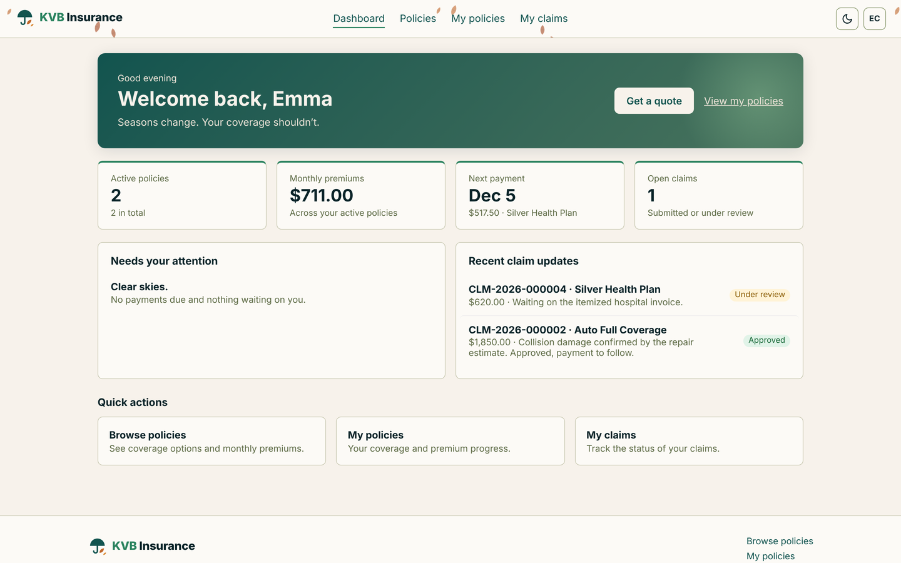
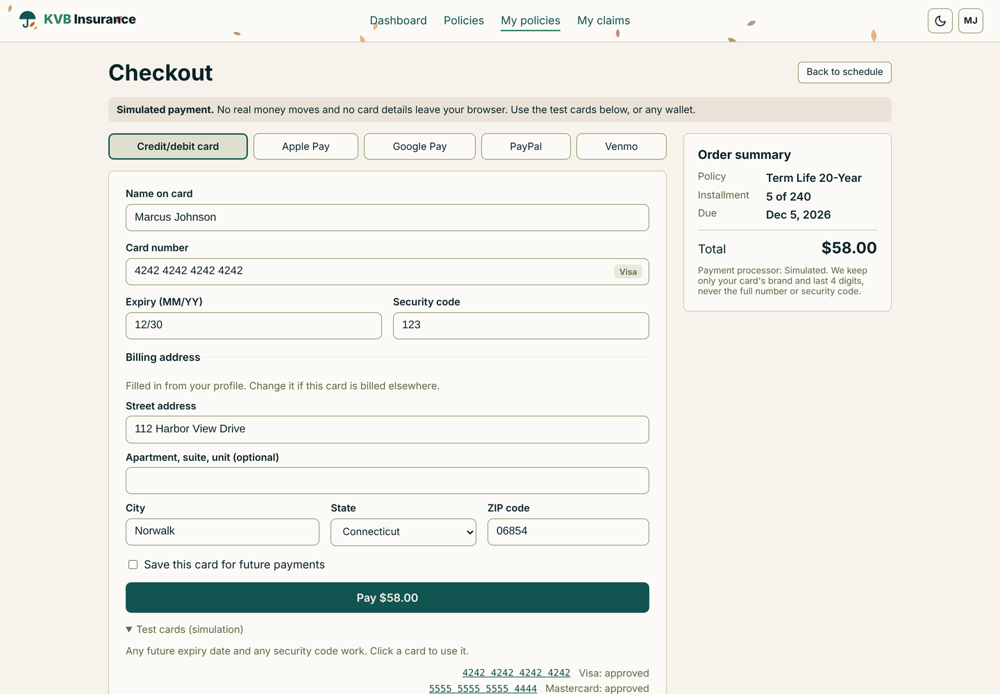
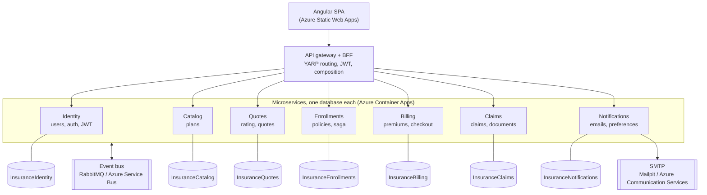
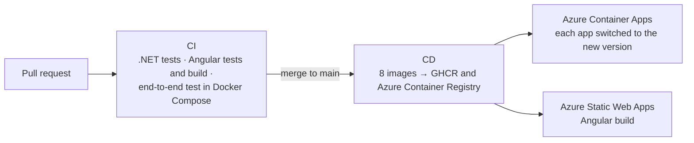

# KVB Insurance

An online insurance platform built as microservices. Customers get **personalized quotes**, enroll in policies, pay monthly premiums through a simulated checkout, file claims with supporting documents, and are kept informed by **email**. Administrators manage the plan catalog, review claims, follow every payment and manage customer accounts.


> **Live site:** <https://salmon-grass-0f7ae9d1e.6.azurestaticapps.net>
> API: <https://gateway.wonderfulpebble-bbe77089.westus3.azurecontainerapps.io/api>
> *(Hosted on low-cost Azure tiers: the first request after a quiet period can take up to a minute while the databases wake up.)*

## Screenshots

| Customer dashboard | Personalized quote | My policies |
|---|---|---|
|  |  |  |

| Checkout | Claims review (admin) | Customer management (admin) |
|---|---|---|
|  |  |  |

## Contents

- [Overview](#overview)
- [Features](#features)
- [Tech stack](#tech-stack)
- [Architecture at a glance](#architecture-at-a-glance)
- [Key business rules](#key-business-rules)
- [Getting started](#getting-started)
- [Demo accounts](#demo-accounts)
- [Testing](#testing)
- [CI/CD and deployment](#cicd-and-deployment)
- [Email notifications](#email-notifications)
- [Configuration reference](#configuration-reference)
- [API overview](#api-overview)
- [Project structure](#project-structure)
- [Known limitations](#known-limitations)
- [Roadmap](#roadmap)
- [Team](#team)

## Overview

KVB Insurance simulates the core operations of an insurer:

1. An admin publishes **plans** (Health, Auto, Life, Home, Travel).
2. A customer answers a short, plan-specific questionnaire. The server **rates** the applicant and issues a **quote**: a price with a full breakdown of how it was calculated, or an underwriting decline.
3. The customer **enrolls** from the quote. A **saga** across three services reserves the quote, creates the policy and its monthly **premium schedule**, and confirms the quote.
4. The customer **pays** installments by card or digital wallet, and can **file claims** with documents against active, paid-up policies.
5. Admins move claims through a **review workflow**, follow the **payment log**, and manage customer accounts.
6. Along the way, customers get **emails**: verification, policy confirmations, receipts and declines, payment reminders, and every step of their claims.

The backend is **seven ASP.NET Core microservices**, each with its own database, behind an **API gateway + BFF**. Services call each other over HTTP for queries and exchange **events** (RabbitMQ locally, Azure Service Bus in the cloud) for everything that changes another service's data. The Angular frontend talks only to the gateway. Inside each service, data access uses **ADO.NET with parameterized stored procedures**. Every pull request is built and tested by GitHub Actions, and every merge to `main` is deployed to Azure automatically.

## Features

### Customers
- **Accounts:** register, verify the email address from a link, sign in and out. Passwords are hashed with BCrypt; sessions use JWTs. Email and password can be changed from the profile page, and both changes are announced by email.
- **Plans and quotes:** browse the catalog and filter by type. The questionnaire for each plan type comes from the API and the form is built from it. The quote shows the base rate, every rating factor, the monthly price, the total over the term and its expiry date.
- **Policies:** enroll from a quote with a chosen start date, see payment progress and alerts ("due soon", "overdue") on each policy, and cancel.
- **Simulated checkout:** pay by card (Visa, Mastercard, Amex, Discover), PayPal, Apple Pay, Google Pay or Venmo. Card details are validated and turned into a token in the browser, so the server never sees a card number. The billing name and address are filled in from sign-up, cards can be saved, every attempt gets a printable receipt, and a full payment history shows declines with their reason.
- **Claims:** file a claim with the incident date, amount, description and up to 5 documents (PDF, JPG, PNG). Follow it through review, read the reviewer's notes, and send more documents when asked.
- **Emails:** receipts and declined-payment notices, payment reminders (opt in or out at sign-up and on the profile), policy and claim updates, and security notices.

### Administrators
- **Plan catalog:** create, edit and deactivate plans. Deactivated plans disappear for customers but stay on existing policies.
- **Claims review queue:** filter by status, read a claim's documents, ask for more information, approve, reject (a reason is required) and mark as paid. Only the legal next steps are offered.
- **Payment log:** every payment attempt from every customer, filterable by status, with amounts collected, declines and refunds.
- **Customer management:** search and filter customers, see their active policies, claims and verification status, edit their details, reset their password (a one-time password is emailed), and deactivate or reactivate accounts. Deactivation takes effect on the customer's very next request.

### Platform
- Role-based authorization (`Customer`, `Admin`) with ownership checks on every record, and consistent RFC 7807 `ProblemDetails` errors.
- **Microservices:** database per service, API gateway (YARP) with BFF composition, event bus (MassTransit), orchestrated saga with compensation, transactional outbox, idempotent consumers, and graceful degradation when a service is down.
- **Light and dark themes**, a responsive layout, and accessible forms and dialogs.
- One `docker compose up` starts the whole system locally: SQL Server, RabbitMQ, Mailpit (a test inbox), seven services and the gateway.

## Tech stack

| Layer | Technology |
|---|---|
| Frontend | Angular 22 (standalone components, signals, lazy-loaded routes, reactive forms), TypeScript, RxJS, CSS with light/dark design tokens |
| Services | C#, .NET 10, ASP.NET Core Web API (one per service), Swagger/OpenAPI |
| API gateway | YARP reverse proxy, JWT validation, active-account check, BFF composition endpoints |
| Messaging | MassTransit on RabbitMQ (local) or Azure Service Bus (cloud), retries, faults, transactional outbox |
| Data | SQL Server / Azure SQL, **one database per service**, ADO.NET (`Microsoft.Data.SqlClient`), parameterized stored procedures and views, migrated by each service at startup |
| Email | SMTP through MailKit: Mailpit locally, Azure Communication Services in the cloud |
| Security | JWT bearer authentication (checked by the gateway and every service), BCrypt, role-based authorization, browser-side payment tokenization |
| Testing | xUnit with hand-written fakes, architecture tests for service boundaries, Vitest for Angular, a Python end-to-end suite against the running system |
| DevOps | Docker, Docker Compose, GitHub Actions (CI and CD), GitHub Container Registry, Azure Container Registry |
| Hosting | Azure Container Apps (services and gateway), Azure SQL, Azure Service Bus, Azure Files (claim documents), Azure Static Web Apps (frontend) |

## Architecture at a glance



| Service | Owns | Talks to |
|---|---|---|
| **Identity** | Users, sign-in, JWTs, email verification, admin account changes | Nobody (others call it). Publishes account events (registered, verification requested, email or password changed, password reset, deactivated, reactivated) |
| **Catalog** | Plans | Nobody (others call it) |
| **Quotes** | Rating engine, quotes | Catalog (HTTP). Consumes `EnrollmentActivated`, `EnrollmentFailed` |
| **Enrollments** | Policies, **the enrollment saga** | Identity, Quotes, Catalog, Billing (HTTP). Publishes `EnrollmentRequested`, `EnrollmentActivated`, `EnrollmentFailed`, `EnrollmentCancelled` (outbox) |
| **Billing** | Premium schedules, checkout, payment log, saved cards, reminders | Enrollments, Identity (HTTP). Consumes enrollment events; publishes `PremiumScheduleCreated`, `PaymentReceived`, `PaymentDeclined`, `PaymentReminderDue` (outbox) |
| **Claims** | Claims, claim documents, review workflow | Enrollments, Billing, Catalog, Identity (HTTP). Publishes `ClaimSubmitted`, `ClaimStatusChanged` (outbox) |
| **Notifications** | Emails sent, email preferences | Identity, Enrollments, Catalog, Claims (HTTP). Consumes the events above and emails the customer. Nothing depends on it |
| **Gateway + BFF** | Nothing | Routes `/api/*`, checks that the caller's account is still active, composes the admin customer list |

**Rules that keep the services independent:** a service never reads another service's database and never references another service's code, only its `*.Contracts` package (events, internal API shapes and a typed HTTP client). `Insurance.Architecture.Tests` fails the build if either rule is broken.

See [docs/ARCHITECTURE.md](docs/ARCHITECTURE.md) for the domain model, the enrollment saga, the outbox, sequence diagrams, the claim workflow, the rating engine, simulated payments, the security model and the error-number registry.

## Key business rules

| Area | Rule |
|---|---|
| Quotes | Priced on the server from the customer's answers; the client never sends a price. Valid for 30 days and usable once. |
| Rating | `premium = base rate x every factor`, rounded to cents, minimum $1.00. Some answers trigger an underwriting decline. |
| Enrollment | Start date from yesterday to 90 days ahead. One active enrollment per plan per customer. The premium is copied from the quote, so later plan price changes never alter existing policies. |
| Payments | Installments are paid **in order**. An unpaid installment is **Overdue** more than **5 days** past its due date; a "due soon" alert shows within **7 days**. A retried payment request is never charged twice. |
| Reminders | Emailed 3 days before the due date, on the due date, when it turns Overdue, then 5 and 10 days later. Customers can turn them off. |
| Email verification | Required before **enrolling** or **filing a claim**. Links are single-use, expire after **15 minutes**, and only their hash is stored. |
| Claims | Active policy only; incident inside the coverage period and not in the future; no overdue premiums; amount within the remaining coverage. |
| Claim workflow | Submitted, Under review, then Approved or Rejected, then (approved only) Paid. A reviewer can ask for more information; the customer adds documents and sends it back. Concurrent reviews are detected. |
| Claim documents | PDF, JPG or PNG (checked from the file's contents), up to 10 MB each and 5 per claim, until a decision is made. They can't be deleted. |
| Accounts | Deactivated accounts can't sign in and their open sessions stop working at once. An admin password reset emails a one-time password valid for 30 minutes, and the customer must choose a new password before doing anything else. |
| Time | "Today" (due dates, overdue, coverage, claim dates) is in the insurer's time zone, US Eastern by default. |

## Getting started

### Prerequisites

- [Docker Desktop](https://docs.docker.com/get-docker/) (with Docker Compose)
- [.NET 10 SDK](https://dotnet.microsoft.com/download), to build, test or run a service outside Docker
- [Node.js](https://nodejs.org/) 24.15 or later (required by Angular 22)
- Recommended VS Code extensions: C# Dev Kit, SQL Server (mssql), Angular Language Service

### 1. Clone

```bash
git clone https://github.com/organizedanvrchy/Insurance-Full-Stack-App-MSA.git
cd Insurance-Full-Stack-App-MSA
```

### 2. Start the backend

```bash
cp deploy/.env.example deploy/.env
```

Edit `deploy/.env` to set your own `SA_PASSWORD` and `JWT_KEY` (32+ characters), then:

```bash
docker compose -f deploy/docker-compose.yml up --build
```

This starts SQL Server, RabbitMQ, Mailpit, the seven services and the gateway. Each service creates its own database on first start, and Catalog seeds 20 plans.

| Address | What |
|---|---|
| <http://localhost:5080/api> | The API (through the gateway) |
| <http://localhost:8025> | Mailpit: **every email the system sends**, including verification links |
| <http://localhost:15672> | RabbitMQ dashboard (guest / guest): queues and events |

### 3. Run the frontend

```bash
cd insurance-web
npm install
npx ng serve
```

Open <http://localhost:4200>. The development build calls the local gateway (`src/environments/environment.development.ts`).

### 4. Create an admin account

There is intentionally no public admin sign-up. Register a normal account, then promote it:

```bash
docker compose -f deploy/docker-compose.yml exec sqlserver /opt/mssql-tools18/bin/sqlcmd -C -S localhost -U sa -P "<your SA_PASSWORD>" -Q "UPDATE InsuranceIdentity.accounts.Users SET Role = 'Admin' WHERE Email = 'you@example.com'"
```

Sign in again so the new role is in your token.

### 5. Optional: load the demo data

```bash
docker compose -f deploy/docker-compose.yml exec sqlserver /opt/mssql-tools18/bin/sqlcmd -C -S localhost -U sa -P "<your SA_PASSWORD>" -i /seed/demo-data.sql
```

`deploy/seed/remove-demo-data.sql` removes it again.

### Running a service outside Docker

Each service is a normal ASP.NET Core project with its own port: gateway 5080, Identity 5101, Catalog 5102, Quotes 5103, Enrollments 5104, Billing 5105, Claims 5106, Notifications 5107. With SQL Server, RabbitMQ and Mailpit running (`docker compose -f deploy/docker-compose.yml up sqlserver rabbitmq mailpit`), set the connection string and JWT key, then run it:

```bash
cd src/Services/Catalog/Insurance.Catalog
dotnet user-secrets set "ConnectionStrings:Database" "Server=localhost,1433;Database=InsuranceCatalog;User Id=sa;Password=<SA_PASSWORD>;TrustServerCertificate=True;"
dotnet user-secrets set "Jwt:Key" "<the same JWT_KEY as every other service>"
dotnet run
```

Each service has Swagger at `/swagger` in the Development environment.

## Demo accounts

After loading the demo data, every demo customer signs in with the password **`Demo#2026pass`**:

| Customer | Email | What to look at |
|---|---|---|
| Emma Carter | `emma.carter@demo.example` | Fully paid up. Claims in **Approved** and **Under review** |
| Marcus Johnson | `marcus.johnson@demo.example` | Home and Life policies. Claims in **Paid** and **Submitted** |
| Priya Patel | `priya.patel@demo.example` | **Overdue premiums** (claims blocked on that policy) |
| Daniel Kim | `daniel.kim@demo.example` | A **Rejected** claim with the reviewer's reason, and an **Expired** policy |
| Sofia Rodriguez | `sofia.rodriguez@demo.example` | A **payment due today**, no claims |
| Tyler Brooks | `tyler.brooks@demo.example` | **Deactivated** account (sign-in is refused) |

**Test cards** for the simulated checkout (any future expiry, any security code):

| Card | Outcome |
|---|---|
| `4242 4242 4242 4242` | Approved |
| `4000 0000 0000 0002` | Declined |
| `4000 0000 0000 9995` | Insufficient funds |
| `4000 0000 0000 0119` | Processing error (can be retried) |

## Testing

| Suite | Command | What it covers |
|---|---|---|
| Backend unit tests | `dotnet test Insurance.sln` | Business logic in every service (rating, saga, checkout, claims, emails, reminders, accounts) with in-memory fakes, plus architecture tests that guard the service boundaries |
| Frontend unit tests | `cd insurance-web && npx ng test --watch=false` | Card validation, utilities and components |
| End to end | `python tests/e2e/e2e_test.py` (with the stack running) | The whole running system through the gateway: accounts and verification emails, quotes, the enrollment saga, payments (declines, retries, receipts), claims, admin screens, deactivation and cancellation |

The architecture tests (`ServiceBoundaryTests`) fail the build if a service references another service's implementation, if a service's SQL touches another service's schema, or if anything depends on the Notifications service.

## CI/CD and deployment



- **CI** (`.github/workflows/ci.yml`) runs on every pull request and every push to `main`.
- **CD** (`.github/workflows/cd.yml`) runs after CI passes on `main`. It publishes an image per service (tags `latest` and `sha-<commit>`), updates every container app in Azure, and deploys the Angular app. GitHub signs in to Azure with OpenID Connect, so no Azure password is stored in GitHub.
- **Azure resources:** Container Apps (only the gateway is public), Azure SQL (one database per service), Service Bus (Standard tier), Azure Files for claim documents, Communication Services for email, Static Web Apps for the frontend. The first-time setup is in [deploy/azure/README.md](deploy/azure/README.md).
- **Rolling back:** point a container app at an earlier `sha-<commit>` tag.

## Email notifications

The **Notifications service** sends every email. It only listens to events the other services already publish, so no service waits for an email or knows the Notifications service exists.

| Email | Sent when | Can be turned off |
|---|---|---|
| Verify your email / your new email | Sign-up, resend, email change | No |
| Email or password changed ("was this you?") | After either change, to the address that was in use | No |
| Account deactivated / reactivated | An admin deactivates or reactivates the account | No |
| Password reset | An admin resets the password: the one-time password and when it expires | No |
| Policy active / cancelled | The enrollment saga completes, the customer cancels | No |
| Payment receipt / payment didn't go through | Every checkout attempt | No |
| Payment reminder | 3 days before, on the due date, when Overdue, +5 and +10 days | **Yes** |
| Claim received / needs more information / approved / rejected / payment sent | Each step of a claim. "Claim received" lists the claim's documents with copies attached | No |

How it stays reliable:

- **Exactly once.** Each email has a key (for example `receipt:123`). A repeated event finds the key already sent and does nothing.
- **Waits out sending limits.** When the mail server says "later", the email is kept as **Waiting** and resent after 1, 5, 15 and 30 minutes, then hourly, for about 13 hours.
- **No lost events.** Billing, Claims and Enrollments publish through a **transactional outbox**: an event exists exactly when its change was committed.
- **Safe content.** Customer-entered text is HTML-encoded, and every email also has a plain-text version.
- **One name.** Every email uses `EmailBuilder.Brand`, so the brand is changed in one place.

## Configuration reference

Every setting can also be given as an environment variable (`:` becomes `__`), which is how Docker Compose and Azure configure the containers. **Never commit secrets:** use `deploy/.env` (ignored by Git), user secrets, or Container App secrets.

| Setting | Used by | Notes |
|---|---|---|
| `ConnectionStrings:Database` | Each service | That service's own database, never shared |
| `Jwt:Key`, `Jwt:Issuer`, `Jwt:Audience`, `Jwt:ExpiryMinutes` | Every service and the gateway | **Secret.** The key is at least 32 characters and the same everywhere; tokens last 60 minutes by default |
| `RabbitMq:Host`, `Username`, `Password` | Services with events | The local event bus |
| `ServiceBus:ConnectionString` | Same services | **Secret.** When set, the event bus is Azure Service Bus (Standard tier) |
| `Email:Host`, `Port`, `Security`, `Username`, `Password` | Notifications | The SMTP server; `Security` is `None`, `StartTls` or `SslOnConnect`. An empty `Host` only logs emails |
| `Email:FromAddress`, `FromName`, `SupportEmail`, `AppBaseUrl` | Notifications | The sender, where customers get help, and where links in emails point |
| `Email:SkipDomains`, `Email:SkipReservedDomains` | Notifications | Recipient domains never emailed; `true` on a real mail server for `example.com`, `*.test` and similar |
| `BusinessTimeZone` | Every service | The insurer's time zone (default `America/New_York`) |
| `Reminders:Enabled`, `Interval` | Billing | The payment reminder job (default on, hourly) |
| `Payments:Provider`, `Payments:Mock:LatencyMs` | Billing | Only `Mock` (the simulated processor) exists today |
| `Services:<Name>` | Callers of another service | Base address of that service's internal API |
| `ReverseProxy:Clusters:<name>:Destinations:d1:Address`, `Cors:AllowedOrigins` | Gateway | Where each service runs; which frontends may call the API |
| `apiUrl` | `insurance-web/src/environments/` | The gateway's address (development and production builds) |

## API overview

Every endpoint is reached through the gateway at `/api`. Statuses follow REST conventions: `201` created, `202` enrollment accepted but still being set up, `204` updated, `400` validation or business rule, `401` not signed in, `403` wrong role or email not verified, `404` not found **or not yours**, `409` state conflict, `429` too many verification emails, `503` a service the request needs is down.

| Area (service) | Endpoints | Access |
|---|---|---|
| **Auth** (Identity) | `POST /auth/register`, `POST /auth/login`, `POST /auth/verify-email` | Public |
| | `GET /auth/me`, `POST /auth/resend-verification`, `POST /auth/change-email`, `POST /auth/change-password`, `POST /auth/choose-new-password` | Signed in |
| **Plans** (Catalog) | `GET /policies`, `GET /policies/{id}` | Signed in |
| | `POST /policies`, `PUT /policies/{id}`, `DELETE /policies/{id}` (soft delete) | Admin |
| **Quotes** (Quotes) | `GET /quotes/questions/{policyId}`, `POST /quotes`, `GET /quotes/{id}` | Customer |
| **Enrollments** (Enrollments) | `GET /enrollments/mine`, `POST /enrollments`, `PUT /enrollments/{id}/cancel` | Customer |
| | `GET /enrollments/{id}` | Owner or admin |
| **Payments** (Billing) | `GET /enrollments/{id}/payments` | Owner or admin |
| | `POST /payments/{id}/pay` (a token or saved method, plus an idempotency key) | Customer |
| | `GET /payments/transactions`, `GET /payments/transactions/{id}` | Own attempts, or everyone's for admins |
| | `GET /payment-methods`, `DELETE /payment-methods/{id}` | Customer |
| **Claims** (Claims) | `POST /claims`, `GET /claims/mine`, `POST /claims/{id}/send-to-reviewer`, `POST /claims/{id}/documents` | Customer |
| | `GET /claims/{id}`, `GET /claims/{id}/documents`, `GET /claims/{id}/documents/{documentId}` | Owner or admin |
| | `GET /claims?status=`, `PUT /claims/{id}/review` | Admin |
| **Notifications** | `GET /notifications/preferences`, `PUT /notifications/preferences` | Customer |
| **Customers** (gateway BFF) | `GET /admin/customers`, `GET /admin/customers/{id}`, `PUT /admin/customers/{id}`, `POST /admin/customers/{id}/reset-password`, `PUT /admin/customers/{id}/active` | Admin |

Services also expose `/internal/*` endpoints to each other. The gateway never routes them.

## Project structure

```
Insurance-Full-Stack-App-MSA/
├── Insurance.sln
├── src/
│   ├── Gateway/Insurance.Gateway/   API gateway + BFF
│   ├── BuildingBlocks/              Shared plumbing: hosting defaults, JWT, database migrator,
│   │                                HTTP clients, messaging, outbox, business time
│   └── Services/                    One folder per microservice:
│       └── <Service>/               Identity, Catalog, Quotes, Enrollments, Billing, Claims, Notifications
│           ├── Insurance.<Service>/            Controllers, Services, Repositories, Messaging,
│           │                                   Database/ (the service's own SQL scripts)
│           └── Insurance.<Service>.Contracts/  What other services may use: events, internal
│                                               API shapes, a typed HTTP client
├── tests/                           xUnit tests per service, architecture tests, e2e/ (Python)
├── deploy/
│   ├── docker-compose.yml           The whole system locally
│   ├── docker-compose.release.yml   Run the published images instead of building
│   ├── Dockerfile                   One image recipe for every service
│   ├── azure/                       First-time Azure setup (script and guide)
│   └── seed/                        Development-only demo data
├── insurance-web/                   Angular app: core/ (services, models, guards, payments),
│                                    features/ (one folder per area), layout/, shared/
├── .github/workflows/               CI and CD
└── docs/                            Architecture document and screenshots
```

## Known limitations

- **Simulated payments.** No money moves. Everything around the processor is built as for a real one (tokens, idempotency keys, a transaction log, refunds, saved methods), so connecting Stripe or similar is a new `IPaymentGateway` class plus its browser library. Webhooks, 3-D Secure and disputes are not simulated.
- **Illustrative pricing.** Rating multipliers are demo values in code, not actuarial data, and can't be edited from the UI.
- **Sessions.** The JWT is kept in `localStorage` with no refresh token, and existing sessions survive a password change until they expire (60 minutes).
- **One symmetric JWT key** is shared by every service; asymmetric signing would be stronger.
- **Synchronous queries.** Some screens need several services to be up; they return `503` when one is down (policy cards degrade gracefully without Billing).
- **No pagination** on the large admin lists, and no malware scanning of uploaded documents.
- **Single admin role**, promoted by SQL; there is no admin-management screen.

## Roadmap

- **Virtual assistant:** a Python/FastAPI chatbot service that answers questions about plans, the customer's own policies and claims (in development)
- A real payment processor (Stripe) with webhooks
- Admin-editable rating factors stored in the database
- Pagination and sorting, an admin analytics dashboard and a "My quotes" screen
- Refresh tokens or httpOnly cookie sessions, and asymmetric JWT signing
- Distributed tracing (OpenTelemetry) across the gateway, services and the bus
- SMS or push notifications

## Team

Built by a team of three as a full-stack microservices project:

- **Vimal Ramnarain** ([@organizedanvrchy](https://github.com/organizedanvrchy))
- **Khalon** ([@KR-Techno](https://github.com/KR-Techno))
- [@BigFigsCode](https://github.com/BigFigsCode)
