# Architecture

This document explains how the Online Insurance Management System is built and why. For setup and usage, see the [README](../README.md).

## Contents

1. [Goals and principles](#1-goals-and-principles)
2. [System context](#2-system-context)
3. [Microservices](#3-microservices)
4. [Request flows](#4-request-flows)
5. [Data model](#5-data-model)
6. [Domain workflows](#6-domain-workflows), including [simulated payments](#64-simulated-payments)
7. [Rating engine](#7-rating-engine)
8. [Security](#8-security)
9. [Error handling and the error-number registry](#9-error-handling-and-the-error-number-registry)
10. [Database object catalog](#10-database-object-catalog)
11. [Consistency: transactions, the saga and the outbox](#11-consistency-transactions-the-saga-and-the-outbox)
12. [Frontend architecture](#12-frontend-architecture)
13. [Conventions](#13-conventions)
14. [Design decisions and trade-offs](#14-design-decisions-and-trade-offs)
15. [Testing strategy](#15-testing-strategy)
16. [Limitations and future work](#16-limitations-and-future-work)

---

## 1. Goals and principles

| Principle | How it shows up |
|---|---|
| **The server owns the truth** | Prices, eligibility and workflow rules are decided in the services and their databases. The Angular app displays results (including alerts and allowed next actions) and never recomputes them. |
| **Independent services** | Six services, each deployable on its own, each the only owner of its own database. A service never reads another's tables and never references another's code. |
| **Queries over HTTP, changes over events** | A service that needs another's data asks its internal API. A service that needs another to *change* something publishes an event; it never writes to another service. |
| **Separation of concerns** | Inside a service: controllers handle HTTP, services hold business rules, repositories hold data access, stored procedures hold data rules and transactions. |
| **Dependency inversion** | Layers, and other services, are reached through interfaces. Each service's `Program.cs` is the only place that chooses concrete classes, so the business logic is unit-testable with fakes. |
| **Fail safely and consistently** | Typed exceptions flow to one handler that returns `ProblemDetails` with the right status code, and they survive the hop between services. |
| **Least privilege** | Every endpoint declares its roles, record ownership is checked on top of roles, and only the gateway is reachable from outside. |
| **One source of truth per rule** | The overdue rule lives in one SQL view (Billing), the workflow in one C# class (Claims), the due-soon window in one constant (Enrollments). |

## 2. System context

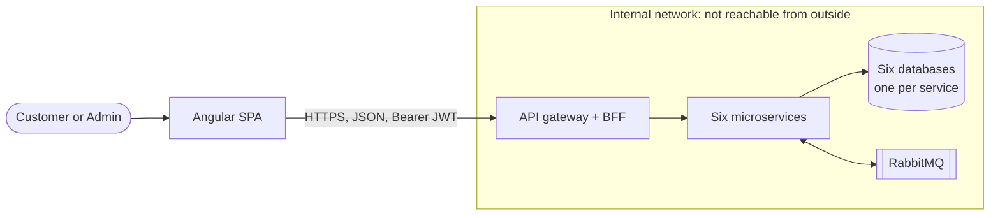

The frontend is a single-page application served as static files. All business operations go through the gateway, which forwards each `/api/*` request to the service that owns it. Each database is reached only by its service.

## 3. Microservices

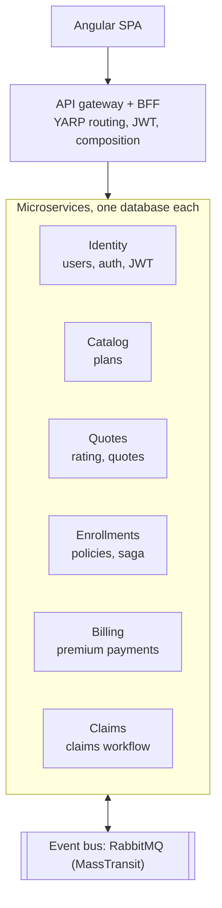

### 3.1 Responsibilities and data

| Service | Database | Owns | Public routes (through the gateway) |
|---|---|---|---|
| **Identity** | `InsuranceIdentity` | Users, password hashes, JWT issuing | `/api/auth/*` |
| **Catalog** | `InsuranceCatalog` | Plans and base rates | `/api/policies/*` |
| **Quotes** | `InsuranceQuotes` | Rating engine, quotes and their reservations | `/api/quotes/*` |
| **Enrollments** | `InsuranceEnrollments` | Policies held by customers, the enrollment saga, the outbox | `/api/enrollments/*` |
| **Billing** | `InsuranceBilling` | Premium schedules and payments | `/api/enrollments/{id}/payments`, `/api/payments/*` |
| **Claims** | `InsuranceClaims` | Claims and the review workflow | `/api/claims/*` |
| **Gateway + BFF** | none | Routing, the active-account check, composition | `/api/admin/customers` (composed) |

### 3.2 How services talk

**Synchronous queries (HTTP).** When a service needs another's data to answer a request, it calls that service's **internal API** (`/internal/*`) through a typed client shipped in the owner's `*.Contracts` project. The caller's JWT is forwarded, so the called service applies its own authorization to the same user. The gateway never routes `/internal`, so these endpoints are reachable only inside the network. A `400`/`404`/`409` from the called service comes back as the same typed exception, so the original message reaches the customer unchanged.

| Caller | Asks | For |
|---|---|---|
| Gateway | Identity | Is this account still active, with the same role? (every request) |
| Gateway (BFF) | Identity, Enrollments, Claims | The admin customer list with policy and claim counts |
| Quotes | Catalog | The plan's base rate and type, when pricing |
| Enrollments | Quotes, Catalog, Billing | Reserving the quote; the plan's term and status; payment progress on policy cards |
| Billing | Enrollments | Who owns an enrollment and whether it is active, when paying |
| Claims | Enrollments, Billing, Catalog, Identity | Eligibility (owner, status, dates, overdue premiums, coverage); names on claim screens |

**Asynchronous events (RabbitMQ through MassTransit).** When something that happened in one service requires another to change its own data, the first publishes an event, and the second reacts in its own transaction. Each subscribing service has its own queue, failed deliveries are retried (100 ms to 15 s), and every consumer is idempotent because delivery is at least once.

| Event | Published by | Consumed by | Effect |
|---|---|---|---|
| `EnrollmentRequested` | Enrollments (outbox) | Billing | Creates the premium schedule, then publishes `PremiumScheduleCreated` |
| `PremiumScheduleCreated` | Billing | Enrollments | Saga: Pending to Active, then publishes `EnrollmentActivated` |
| `Fault<EnrollmentRequested>` | MassTransit, after Billing's last retry | Enrollments | Saga: Pending to Failed, then publishes `EnrollmentFailed` |
| `EnrollmentActivated` | Enrollments | Quotes | The reserved quote becomes used for good |
| `EnrollmentFailed` | Enrollments | Quotes, Billing | Compensation: the quote is released, any schedule removed |
| `EnrollmentCancelled` | Enrollments (outbox) | Billing | Unpaid installments are removed; paid ones stay as history |

### 3.3 What keeps them independent

| Rule | Enforced by |
|---|---|
| A service references only `Insurance.BuildingBlocks` and other services' `*.Contracts` projects | Project references, plus `Insurance.Architecture.Tests` (fails the build otherwise) |
| A service's SQL touches only its own schema | Each service has its own database; `ServiceBoundaryTests` also scans every embedded SQL script |
| A service's database is created and upgraded by that service | `DatabaseMigrator` runs the service's own `Database/*.sql` at startup, recorded in `dbo.SchemaVersions` |
| Only the gateway is exposed | Docker Compose publishes only the gateway's port; in Azure, only the gateway gets external ingress |

### 3.4 Inside a service

Every service has the same layers, and `ServiceDefaults` in BuildingBlocks gives them the same hosting setup (JSON options, error handling, Swagger, JWT, health check at `/health`):

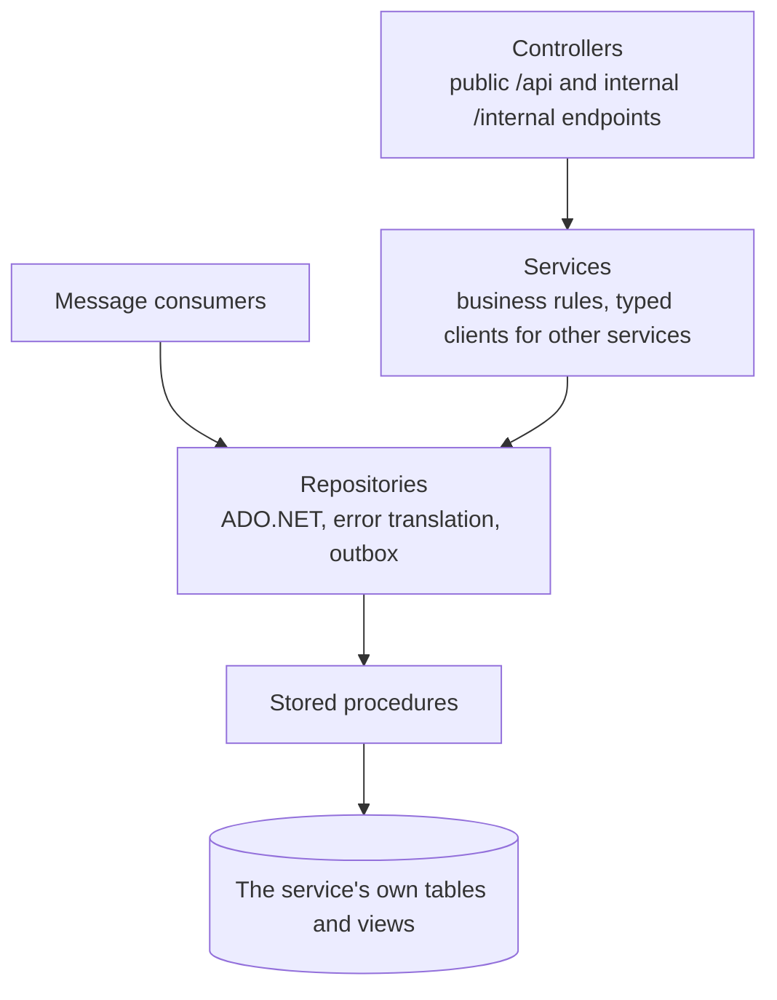

| Layer | Responsibility | Must not |
|---|---|---|
| **Controllers** | Routing, role attributes, reading the caller's id from the token, choosing success status codes | Contain business rules or SQL |
| **Services** | Business rules (date windows, workflow transitions, rating, ownership decisions), composing data from other services, mapping models to DTOs | Know about HTTP details or SQL |
| **Consumers** | React to another service's event with this service's own change | Call other services (they run without a user) |
| **Repositories** | ADO.NET calls to stored procedures, mapping rows to models, translating SQL error numbers into typed exceptions, writing to the outbox | Contain business decisions |
| **Stored procedures** | Data rules that must be atomic, transactions, locking, ownership filters | Know about HTTP, or any other service's data |
| **Rating engine** | Pure functions from answers to a price or a decline | Touch the database |

**Why stored procedures:** they give a clear contract between the code and the database, remove SQL injection from the picture (the C# code never builds SQL strings), and keep each service's multi-step operations (paying, filing and reviewing a claim, reserving a quote) atomic.

**Dependency injection lifetimes**

| Lifetime | Registered types | Reason |
|---|---|---|
| Singleton | `IDbConnectionFactory`, `IRatingStrategy` implementations, the outbox | Stateless. Connections are created per operation and pooled by ADO.NET |
| Scoped | Repositories, services, consumers, token service | One per HTTP request or message |
| Typed `HttpClient` | Clients for other services | Pooled handlers; each adds the caller's JWT |

## 4. Request flows

### 4.1 Sign-in and token use

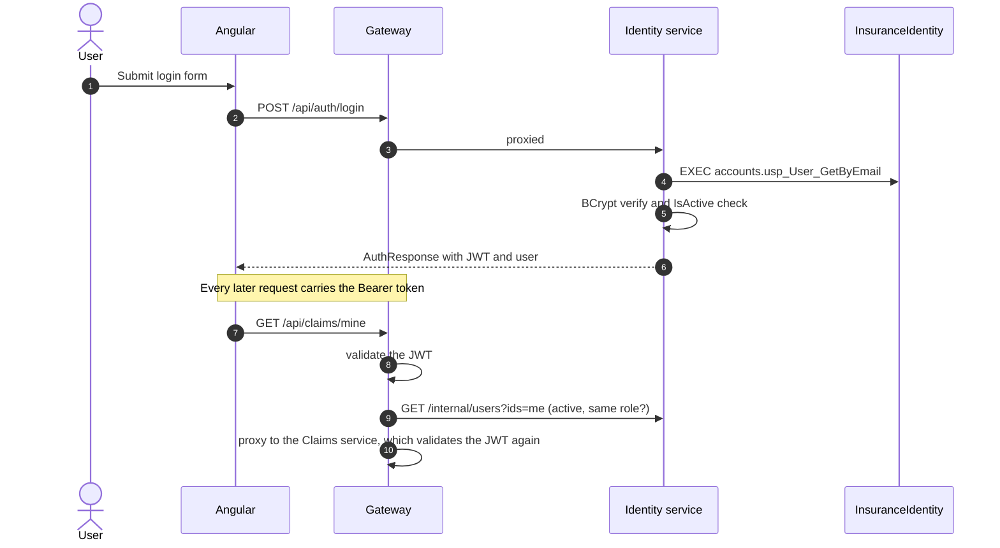

### 4.2 Quote and enrollment: the enrollment saga

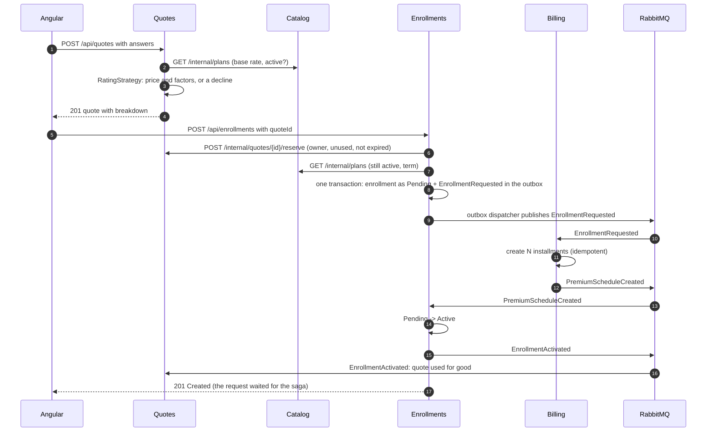

The Enrollments service **orchestrates** the saga, and the enrollment's `Status` column is the saga's state (`Pending`, then `Active` or `Failed`):

- **Immediate answers.** Steps that can refuse the customer (quote not found, already used or expired; plan retired; already enrolled) happen synchronously before anything is published, so they still return `400`/`404`/`409` at once. If the plan check or the duplicate check refuses, the quote reservation is released.
- **Waiting for the saga.** `POST /api/enrollments` polls its own database until the enrollment leaves `Pending` (normally a few milliseconds), then returns `201`. If it is still pending after `Enrollment:SagaTimeout` (10 s), it returns `202 Accepted` with the pending enrollment, and the saga finishes in the background. This was tested by stopping Billing during an enrollment: the customer got `202`, and the policy became active as soon as Billing restarted and processed the queued event.
- **Compensation.** If Billing keeps failing, MassTransit publishes `Fault<EnrollmentRequested>` after the last retry. Enrollments marks the enrollment `Failed` (hidden from customers) and publishes `EnrollmentFailed`; Quotes releases the quote and Billing removes anything it created. The customer can enroll again with the same quote. This was tested by breaking Billing's table during an enrollment.
- **Reservations expire.** A quote is held for 5 minutes. If everything crashes mid-saga, the quote becomes usable again on its own.

### 4.3 Composition in the BFF

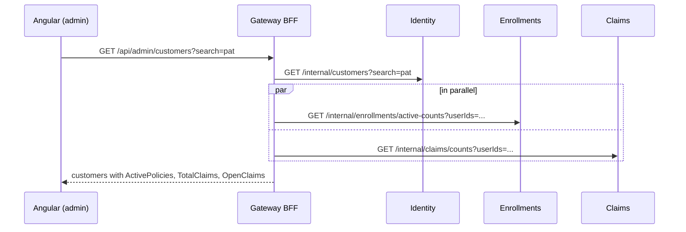

One call per service, whatever the number of customers. The other screens that combine data (policy cards with plan names and payment progress, claims with customer and reviewer names) are composed the same way by the owning service: one batched `GetManyAsync(ids)` call per service it needs.

## 5. Data model

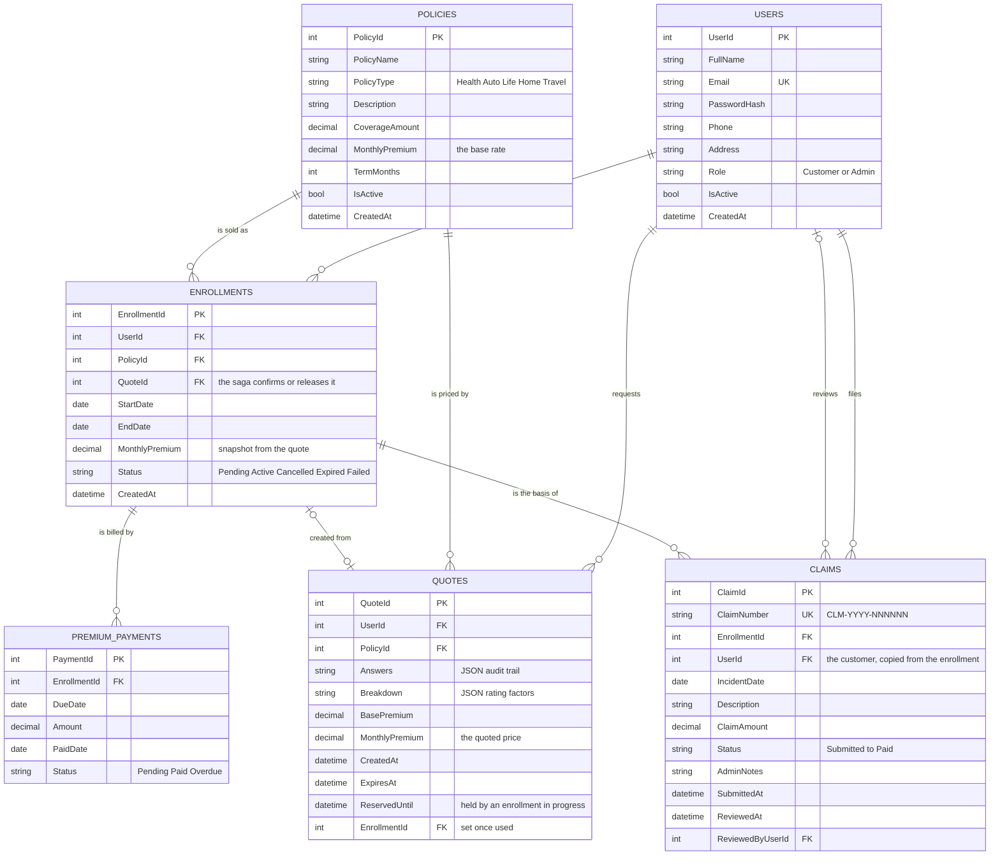

> In the database the payments table is named `PremiumPayments`. It is written with an underscore in the diagram only because Mermaid requires it.

**One database per service.** `accounts.Users` lives in `InsuranceIdentity`, `catalog.Policies` in `InsuranceCatalog`, `quotes.Quotes` in `InsuranceQuotes`, `enrollments.Enrollments` (and `dbo.OutboxMessages`) in `InsuranceEnrollments`, `billing.PremiumPayments` in `InsuranceBilling`, and `claims.Claims` (and `claims.ClaimNumberSeq`) in `InsuranceClaims`. The relationships in the diagram are logical: a column holds another service's id, but **there are no foreign keys between services**, because no database can enforce them across databases. The services keep them consistent through the rules in section 11.

**Design notes**

- **Premium snapshot.** `Enrollments.MonthlyPremium` is copied from the quote. Changing a plan's base rate later never changes existing policies.
- **Soft deletes.** Plans and customers are deactivated (`IsActive = 0`), never deleted, because enrollments and claims reference them. This is also what makes lookups across services safe without foreign keys.
- **Claims carry their customer.** `Claims.UserId` is copied from the enrollment when the claim is filed, so "my claims" is answered inside the claims schema.
- **Derived statuses.** `Expired` (an enrollment past its end date) and `Overdue` (a payment more than 5 days late) are computed in views at read time, so no background job has to keep a column in sync.
- **Constraints as a backstop.** `CHECK` constraints mirror each C# enum (roles, plan types, statuses), and `UNIQUE` constraints protect emails and claim numbers.
- **Quotes keep an audit trail.** The raw answers and the factor breakdown are stored as JSON (guarded by `ISJSON` checks), so any price can be explained later.
- **Claim numbers** come from a database `SEQUENCE` (`claims.ClaimNumberSeq`), formatted `CLM-<year>-<6 digits>`. A rolled-back insert can leave a gap, which is normal.

## 6. Domain workflows

### 6.1 From plan to policy

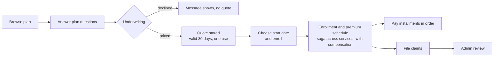

### 6.2 Claim workflow

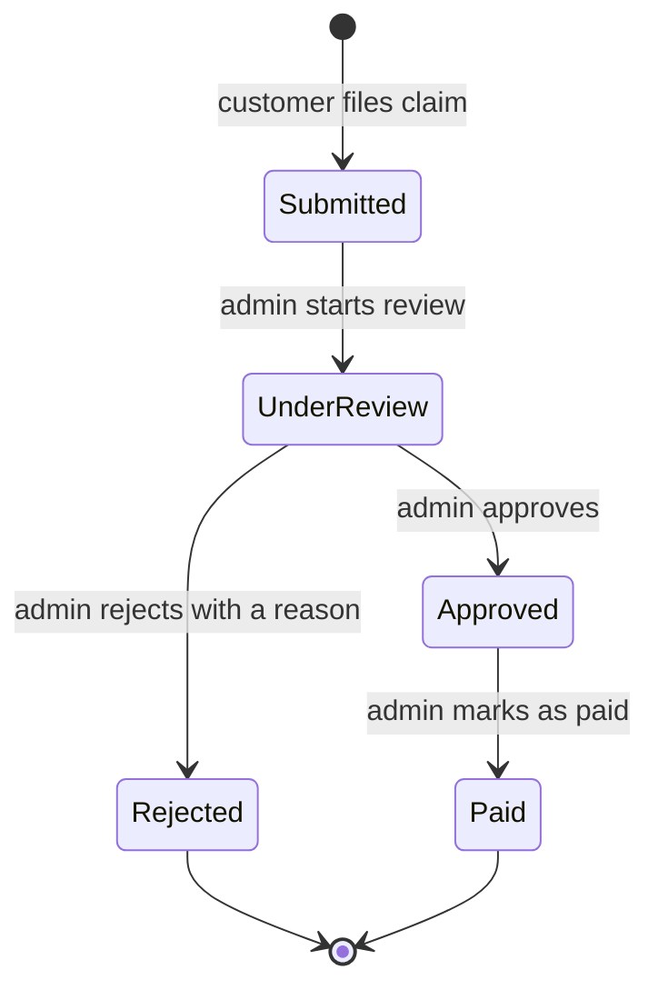

The allowed moves live in **one** place, the `ClaimStatusTransitions` class. The API returns `allowedNextStatuses` on each claim for admins, so the UI shows only legal buttons and holds no copy of the rules. `usp_Claim_Review` takes the status the caller *believes* the claim is in (`@FromStatus`) and only updates if it still matches. This is optimistic concurrency: two admins acting on the same claim cannot silently overwrite each other, and the loser receives a `409`.

**Claim eligibility.** Rules 1 to 4 need other services' data, so `ClaimService` checks them by asking those services. Rule 5 needs a lock on the Claims service's own rows, so it stays in `claims.usp_Claim_Submit`:

1. The enrollment belongs to the caller (Enrollments service).
2. It is active and has not ended (Enrollments service, derived status).
3. The incident date is inside the coverage period and not in the future.
4. No installment is overdue (Billing service, from `billing.vw_PaymentDetails`, the same source as the Overdue badge).
5. The amount does not exceed the remaining coverage: the plan's coverage (Catalog service) minus approved and paid claims. Approval re-checks this, so two claims cannot together exceed it.

### 6.3 Derived statuses and alerts

| Concept | Rule | Where it lives |
|---|---|---|
| Enrollment **Expired** | Stored `Active` and `EndDate` is before today (UTC) | `enrollments.vw_EnrollmentDetails` |
| Payment **Overdue** | Stored `Pending` and due more than **5 days** ago | `billing.vw_PaymentDetails` |
| Alert **Overdue** | Active enrollment with at least one overdue payment | Billing's `usp_Premium_GetSummaries` (count) and `EnrollmentService` |
| Alert **DueSoon** | Active, nothing overdue, next unpaid installment due within **7 days** | `EnrollmentService` (`DueSoonDays` constant) |
| Alert **None** | Anything else, including cancelled policies | `EnrollmentService` |

### 6.4 Simulated payments

Paying a premium works like a real card-processor integration, with a simulated processor behind one interface. Nothing else would change if a real processor (Stripe, Braintree, Adyen) replaced it.

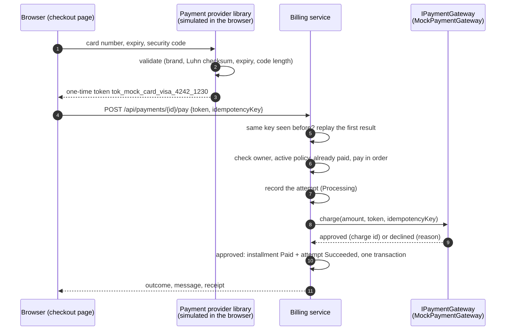

| Concept | How it is done here | Why a real system needs it |
|---|---|---|
| **Tokenization** | The card number and security code stay in the browser. `PaymentProvider` (Angular) turns them into a token; the API's request has no field for a card number, and the gateway rejects anything that isn't a token. | Keeps card data out of your servers and logs, which keeps most of PCI DSS out of scope. |
| **Gateway abstraction** | `IPaymentGateway` in Billing (describe, charge, save for reuse, remove, refund), chosen by `Payments:Provider`. The Angular `PaymentProvider` is the browser half. | Switching processors means one new class on each side, not a rewrite. |
| **Idempotency keys** | The browser makes a new key per attempt. The same key again (a retry after a timeout) returns the first result; the database enforces one attempt per key per customer, and the processor also deduplicates. | A network retry must never charge a customer twice. |
| **Transaction log** | `billing.PaymentTransactions`: every attempt with status (Processing, Succeeded, Declined, Failed, Refunded), decline code, processor reference, brand and last 4 digits. | Support, disputes, accounting, and the customer's own history. |
| **Check before charging** | Ownership, policy status, already paid and pay-in-order are checked before the processor is called; settling re-checks them under a lock. | Never take money that can't be applied. |
| **Automatic refund** | If an approved charge can't be applied (another payment won a race), it is refunded and logged as Refunded; the customer gets the usual `409`. | The rare case where checks pass but the update fails. |
| **Saved methods** | "Save this card" asks the processor for a reusable reference (`pm_...`), stored with brand, last 4 and expiry. Removing it removes it at the processor too. | One-click payments without ever storing a card number. |
| **Declines are outcomes** | A decline is HTTP `200` with `outcome: Declined` and a reason the customer can act on; the attempt is in the log. | The request was valid; the bank said no. |
| **Safe logs** | Each attempt is logged with its reference, outcome, brand and last 4 digits, never the token. | Logs are read by many people and kept for a long time. |

The simulated processor decides outcomes like a processor's test mode, from the card's last 4 digits: `4242 4242 4242 4242` is approved, `4000 0000 0000 0002` is declined, `…9995` has insufficient funds, `…0069` is expired, `…0127` has a wrong security code, `…0119` is a processing error. Wallets (PayPal, Apple Pay, Google Pay, Venmo) open a simulated approval window and are approved. Name and billing address are filled in from the address given at sign-up (`core/utils/address.ts`).

**Not simulated yet:** webhooks (real processors confirm some payments later, asynchronously), 3-D Secure challenges, disputes, and a reconciliation job for the rare charge that succeeds while the service crashes before recording it (it would stay `Processing`).

## 7. Rating engine

Pricing is rule-based. Each plan type has its own strategy, and all share one contract.

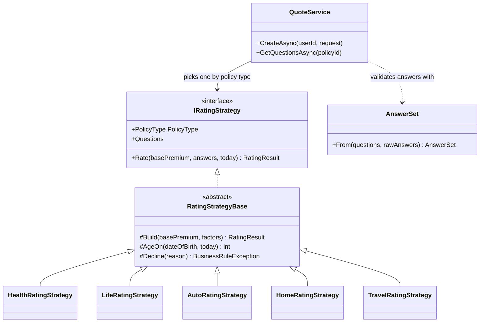

**How a quote is produced**

1. `QuoteService` receives every registered `IRatingStrategy` through DI and indexes them by `PolicyType`. Adding a new plan type means adding one strategy class and one registration.
2. `AnswerSet.From` validates the raw JSON answers against the strategy's `QuestionDefinition` list (type, range, allowed options), so strategies read typed values without re-checking.
3. The plan's `MonthlyPremium` is treated as the **base rate**. `Rate` multiplies it by each factor, rounds to cents (away from zero) and enforces a $1.00 minimum.
4. A decline is a `BusinessRuleException`, which becomes a `400` with the reason.
5. The result, the answers and the factor breakdown are stored in `Quotes`. Enrollment later reads the stored price, so a client can never choose its own.

**Server-driven questionnaire.** `GET /api/quotes/questions/{policyId}` returns the strategy's questions. Angular builds its reactive form from that list, including validators. A new question added in C# appears in the UI with no frontend change.

### Rating factors

> These multipliers are illustrative demo values, not actuarial data.

| Plan type | Factor | Values (multiplier) | Decline |
|---|---|---|---|
| **Health** | Age | under 30: 0.85 · 30-44: 1.00 · 45-59: 1.35 · 60+: 1.80 | under 18 |
| | Tobacco | yes: 1.40 · no: 1.00 | |
| | Conditions | None: 1.00 · Minor: 1.15 · Major: 1.45 | |
| **Life** | Age | under 30: 0.70 · 30-44: 1.00 · 45-59: 2.00 · 60-69: 3.50 | under 18, or 70+ |
| | Tobacco | yes: 1.90 · no: 1.00 | |
| | Conditions | None: 1.00 · Minor: 1.25 · Major: 1.80 | |
| **Auto** | Driver age | under 25: 1.60 · 25-64: 1.00 · 65+: 1.20 | under 18 |
| | Vehicle age | up to 3 years: 1.15 · 4-10: 1.00 · over 10: 0.90 | |
| | At-fault accidents (5 yrs) | 0: 1.00 · 1: 1.30 · 2: 1.70 · 3: 2.20 | 4 or more |
| | Annual mileage | under 7,500: 0.90 · 7,500-15,000: 1.00 · over 15,000: 1.20 | |
| **Home** | Home age | up to 10 years: 0.95 · 11-30: 1.00 · 31-60: 1.15 · over 60: 1.35 | |
| | Monitored security | yes: 0.90 · no: 1.00 | |
| | Claims (5 yrs) | 0: 1.00 · 1: 1.20 · 2: 1.50 | 3 or more |
| **Travel** | Traveler age | under 30: 0.90 · 30-59: 1.00 · 60+: 1.40 | under 18 |
| | Trip length | up to 14 days: 1.00 · 15-30: 1.25 · over 30: 1.60 | |
| | Destination | Domestic: 1.00 · International: 1.45 | |

**Worked example (Auto, base $120):** driver aged 22 (x1.60), 2020 vehicle (x1.00), one at-fault accident (x1.30), mid mileage (x1.00). 120 x 1.60 x 1.30 = **$249.60 / month**.

## 8. Security

### Authentication

- Passwords are hashed with **BCrypt** (salted, with an adaptive work factor) in the Identity service. Only the hash is stored, and it never leaves the Identity service (its internal API returns `UserAccount`, which has no hash).
- Sign-in issues an HS256-signed **JWT** carrying the user id, email, name and role. It expires after `Jwt:ExpiryMinutes` (60 by default), with a one-minute clock skew.
- Login returns the same `401` for an unknown email, a wrong password and a deactivated account, so attackers cannot discover which emails exist.
- **Validated twice.** The gateway validates every token, and so does every service (defense in depth: a service never trusts a request just because it came from inside the network).
- **Active-account check on every request, at the gateway.** After validating the signature, the gateway asks the Identity service whether the account still exists, is active and has the same role, and returns `401` otherwise. Deactivation therefore takes effect immediately, not when the token expires. Any request carrying an invalid or stale token gets `401`, except sign-in and registration.
- **Service-to-service calls carry the user's token**, so each service applies its own role and ownership checks to the real caller. Message consumers run without a user and only touch their own service's data.

### Authorization

Roles are enforced with `[Authorize(Roles = ...)]`, and **ownership is enforced separately** in services and procedures. Using someone else's record returns `404`, not `403`, so ids cannot be probed.

| Capability | Anonymous | Customer | Admin |
|---|:---:|:---:|:---:|
| Register, sign in | yes | | |
| Browse plans | | yes | yes |
| Create, edit, deactivate plans | | | yes |
| Get quotes, enroll, cancel, pay premiums | | yes (own) | |
| View an enrollment or payment schedule | | yes (own) | yes (any) |
| File claims, list own claims | | yes | |
| List all claims, review claims | | | yes |
| Manage customer accounts | | | yes |

### Other protections

- **Network:** only the gateway is published. The services' `/internal` endpoints are never routed by the gateway, and they still require a valid token.
- **SQL injection:** all data access is through typed, parameterized stored procedures. No SQL is concatenated in C# (the database migrator only runs the service's own embedded scripts).
- **Mass assignment:** request DTOs expose only the fields a client may set. For example, `RegisterRequest` has no `Role`, and the service forces `Customer`. The caller's id always comes from the token, never from the request.
- **Data exposure:** responses use DTOs, so `PasswordHash` never leaves the Identity service.
- **Enums on the wire:** values travel as names, and unknown names or numbers are rejected with a `400`. Required enum and boolean request fields are nullable plus `[Required]`, so a missing field cannot silently become a default (such as "deactivate").
- **Secrets:** the JWT key and connection strings are kept in user secrets or `deploy/.env` locally (ignored by Git), and in a secret store when hosted. They are never committed.
- **CORS:** handled by the gateway; allowed origins come from configuration (`Cors:AllowedOrigins`), not code.

## 9. Error handling and the error-number registry

### 9.1 How errors travel

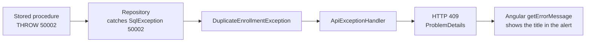

Each layer translates the error for the layer above it. Controllers contain no try/catch blocks. Anything the handler does not recognize falls through to ASP.NET Core's standard `500` `ProblemDetails`.

`ApiExceptionHandler` lives in `Insurance.BuildingBlocks`, is used by every service and the gateway, and knows only three base types. Every service's exceptions derive from one of them, so the handler never needs to know about a service.

**Across services:** when a service answers another service with `400`, `404` or `409`, the calling service's HTTP client turns the `ProblemDetails` back into `BusinessRuleException`, `NotFoundException` or `ConflictException` with the same title. For example, an expired quote found by the Quotes service during an enrollment reaches the customer as the same `400` and message as before. A service that cannot be reached at all becomes a `503`.

All error bodies follow RFC 7807 `ProblemDetails`, with `status` and `title`. Model validation failures (`[ApiController]`) return a `400` with an `errors` dictionary.

### 9.2 Exception to HTTP status

| Exception (base type in bold) | Status | Typical meaning |
|---|:---:|---|
| **`BusinessRuleException`** | 400 | A rule rejected the input (dates, amounts, answers, an underwriting decline) |
| **`NotFoundException`**, and `PaymentNotFoundException` | 404 | Does not exist, or is not yours |
| **`ConflictException`**, and `DuplicateEmailException`, `DuplicateEnrollmentException`, `PaymentConflictException`, `ClaimConflictException` | 409 | The request conflicts with the current state |
| `HttpRequestException` | 503 | Another service this request needs is down or failed |
| Anything else | 500 | Unexpected failure |

### 9.3 Error-number registry

Custom SQL errors use numbers from **50001** upward (`THROW` requires 50000 or above). Each number is a contract between a stored procedure and a repository `catch` block.

Some rules read another service's data, so they are checked in a service's C# code instead of SQL. They **keep the same message and HTTP status** as when they were SQL errors; they are listed as "service" below, and their numbers are retired rather than reused. Error numbers are unique across all services, so a number always identifies one rule.

| No. | Raised by | Meaning | Exception | HTTP |
|---:|---|---|---|:---:|
| 50001 | Identity: `accounts.usp_User_Register` | Email already registered | `DuplicateEmailException` | 409 |
| 50002 | Enrollments: `enrollments.usp_Enrollment_CreatePending` | Active enrollment already exists for this plan | `DuplicateEnrollmentException` | 409 |
| (50003) | Service: `QuoteService`, `EnrollmentService` | Plan does not exist or was retired (quote: 404, enrolling from an old quote: 400) | `NotFoundException` / `BusinessRuleException` | 404 / 400 |
| 50004 | Billing: `billing.usp_Payment_Settle`, and `CheckoutService` for "not yours" | Payment not found, or not yours (deliberately the same message) | `PaymentNotFoundException` | 404 |
| 50005 | Billing: `billing.usp_Payment_Settle` (and checked first by `CheckoutService`) | Installment already paid | `PaymentConflictException` | 409 |
| (50006) | Service: Billing's `CheckoutService` | Enrollment is not active | `PaymentConflictException` | 409 |
| 50007 | Billing: `billing.usp_Payment_Settle` (and checked first by `CheckoutService`, before charging) | An earlier installment is still unpaid | `PaymentConflictException` | 409 |
| (50008) | Service: Claims' `ClaimService` | Enrollment not found, or not yours | `NotFoundException` | 404 |
| (50009) | Service: Claims' `ClaimService` | Enrollment is not active | `ClaimConflictException` | 409 |
| (50010) | Service: Claims' `ClaimService` | Incident date outside coverage, or in the future | `BusinessRuleException` | 400 |
| (50011) | Service: Claims' `ClaimService` | Overdue premiums block the claim | `ClaimConflictException` | 409 |
| 50012 | Claims: `claims.usp_Claim_Submit` | Amount exceeds remaining coverage | `BusinessRuleException` | 400 |
| 50013 | Claims: `claims.usp_Claim_Review` | Claim changed by someone else (stale `@FromStatus`) | `ClaimConflictException` | 409 |
| 50014 | Claims: `claims.usp_Claim_Review` | Claim not found | `NotFoundException` | 404 |
| 50015 | Claims: `claims.usp_Claim_Review` | Approval would exceed remaining coverage | `ClaimConflictException` | 409 |
| 50016 | Quotes: `quotes.usp_Quote_Reserve` | Quote not found, or not yours | `NotFoundException` | 404 |
| 50017 | Quotes: `quotes.usp_Quote_Reserve` | Quote has expired | `BusinessRuleException` | 400 |
| 50018 | Quotes: `quotes.usp_Quote_Reserve` | Quote already used, or held by an enrollment in progress | `ConflictException` | 409 |
| 50019 | Claims: `claims.usp_Claim_Review` | Approving without `@CoverageAmount` (a bug in the caller, never a user error) | none | 500 |
| 50100 | `deploy/seed/demo-data.sql` | Required plans missing (script only, never raised by the API) | none | none |

**SQL Server engine errors also handled:** `2601` and `2627` (unique index or constraint violation), which `UserRepository` maps to `DuplicateEmailException` so two simultaneous sign-ups with the same email still get a clean `409`.

**Adding a new error number**

1. Take the next unused number (**50020**).
2. `THROW` it in the service's stored procedure with a user-friendly message.
3. Add a `catch (SqlException ex) when (ex.Number == 50019)` in the repository that throws a typed exception.
4. If the exception is new, derive it from `BusinessRuleException`, `NotFoundException` or `ConflictException`.
5. Add a row to this table and test the path in Swagger.

## 10. Database object catalog

Each service creates its own database from the scripts in its `Database/` folder (embedded in the service and run by `DatabaseMigrator` at startup; applied scripts are recorded in `dbo.SchemaVersions`). `@...Ids` parameters are JSON arrays (`[1,2,3]`) read with `OPENJSON`, so one internal API call can fetch many rows.

| Database (service) | Tables and views | Stored procedures |
|---|---|---|
| `InsuranceIdentity` | `accounts.Users` | `usp_User_Register`, `usp_User_GetByEmail`, `usp_User_GetById`, `usp_User_GetMany`, `usp_Customer_GetAll`, `usp_Customer_SetActive` |
| `InsuranceCatalog` | `catalog.Policies` (20 plans seeded by `002_seed_plans.sql`) | `usp_Policy_Create`, `usp_Policy_GetAll`, `usp_Policy_GetById`, `usp_Policy_GetMany`, `usp_Policy_Update`, `usp_Policy_Deactivate` |
| `InsuranceQuotes` | `quotes.Quotes` | `usp_Quote_Create`, `usp_Quote_GetById`, `usp_Quote_Reserve`, `usp_Quote_Release`, `usp_Quote_MarkUsed` |
| `InsuranceEnrollments` | `enrollments.Enrollments`, `enrollments.vw_EnrollmentDetails` (derived `Expired`), `dbo.OutboxMessages` | `usp_Enrollment_CreatePending`, `usp_Enrollment_Complete`, `usp_Enrollment_GetByUser`, `usp_Enrollment_GetById`, `usp_Enrollment_GetMany`, `usp_Enrollment_CountActiveByUser`, `usp_Enrollment_Cancel` |
| `InsuranceBilling` | `billing.PremiumPayments`, `billing.vw_PaymentDetails` (derived `Overdue`, with the grace period), `billing.PaymentTransactions` (the payment log), `billing.SavedPaymentMethods` | `usp_Premium_CreateSchedule` (idempotent), `usp_Premium_RemoveUnpaid`, `usp_Premium_GetSummaries`, `usp_Payment_GetByEnrollment`, `usp_Payment_GetById`, `usp_Payment_Settle`, `usp_Transaction_Begin` / `_Complete` / `_GetById` / `_GetByKey` / `_Search`, `usp_SavedMethod_GetByUser` / `_GetById` / `_Add` / `_Delete` |
| `InsuranceClaims` | `claims.Claims`, `claims.ClaimNumberSeq`, `claims.vw_ClaimDetails` | `usp_Claim_Submit`, `usp_Claim_GetByUser`, `usp_Claim_GetAll`, `usp_Claim_GetById`, `usp_Claim_Review`, `usp_Claim_CountByUser` |

## 11. Consistency: transactions, the saga and the outbox

A transaction never spans two services. Each service keeps its own invariants with local transactions and locks; work that spans services is a saga of local steps connected by events.

| Operation | Where | Locking and consistency |
|---|---|---|
| Reserve a quote | Quotes: `usp_Quote_Reserve` | `UPDLOCK` on the quote, so two enrollments can't both take it. The hold lasts 5 minutes unless confirmed |
| Enroll | Enrollments: saga (section 4.2); `usp_Enrollment_CreatePending` | `UPDLOCK, HOLDLOCK` on the duplicate check, which counts Pending enrollments too. The row and `EnrollmentRequested` commit together through the outbox |
| Create the schedule | Billing: `usp_Premium_CreateSchedule` | Does nothing if the schedule exists, so a redelivered event is harmless |
| Cancel | Enrollments: `usp_Enrollment_Cancel` | The `WHERE` clause enforces ownership and `Active` status; `EnrollmentCancelled` commits with it through the outbox. Billing removes the unpaid installments when it receives it |
| Pay | Billing: `CheckoutService`; `usp_Transaction_Begin`, then `usp_Payment_Settle` | One attempt per idempotency key (`UPDLOCK, HOLDLOCK` on the key). Every rule is checked before charging; after an approved charge, `usp_Payment_Settle` marks the installment paid and the attempt Succeeded in one transaction with `UPDLOCK` on the installment, re-checking "already paid" and ordering. If that fails, the charge is refunded (section 6.4) |
| File a claim | Claims: `ClaimService`; `usp_Claim_Submit` | Eligibility from other services. The proc takes `UPDLOCK, HOLDLOCK` on the enrollment's approved claims while checking remaining coverage |
| Review a claim | Claims: `usp_Claim_Review` | **Optimistic concurrency** through `WHERE Status = @FromStatus`. On approval, locks the enrollment's claims and re-checks remaining coverage against the plan coverage the service passes in |
| Set customer active | Identity: `usp_Customer_SetActive` | A single `UPDATE`, restricted to `Role = 'Customer'` so admins cannot be deactivated through this path |

Every multi-statement procedure uses `SET XACT_ABORT ON`, so a runtime error rolls the whole transaction back.

**Transactional outbox.** Publishing an event right after a database commit can go wrong in two ways: the process can die between the commit and the publish (the event is lost and the saga hangs), or the publish can succeed for a change that then rolls back. So the Enrollments service writes its events to `dbo.OutboxMessages` **in the same transaction** as the change, and `OutboxDispatcher` (a background service) publishes them to RabbitMQ and marks them published. It is woken right after each commit, and polls every 2 seconds in case it missed a signal. `READPAST` locking lets several instances of the service share the outbox without publishing a message twice at the same time.

**At-least-once delivery, idempotent consumers.** The outbox and MassTransit's retries mean a message can arrive twice, never zero times. Every consumer is written so that a second delivery changes nothing: creating a schedule that exists does nothing, completing a completed saga returns the same row, marking a used quote as used again is a no-op.

**Eventual consistency, hidden where it matters.** Billing creates the schedule a moment after the enrollment is saved, and removes unpaid installments a moment after a cancellation. The customer never sees these gaps: enrolling waits for the saga, and Billing treats a cancelled policy's unpaid installments as already gone (`PaymentService.IsStillDue`).

**Graceful degradation.** If Billing is down, policy cards still load without payment progress. Rules that protect money (paying, filing a claim) never degrade: they return `503` instead.

## 12. Frontend architecture

**Stack:** Angular with standalone components, signals, the built-in `@if` / `@for` control flow, reactive forms, lazy-loaded routes, a functional HTTP interceptor and functional route guards.

```
src/app/
  core/
    api.config.ts        API base URL
    models/              TypeScript mirrors of API DTOs, plus enums
    services/            One service per API controller, plus AuthService
    interceptors/        auth.interceptor: attaches the JWT, signs out on 401
    guards/              authGuard and roleGuard
    utils/               getErrorMessage, label helpers
  features/              auth, dashboard, policies, enrollments, payments,
                         claims, customers, not-found
  layout/                Shell component (navigation plus router outlet)
```

**Patterns**

- **Service per controller.** Components never build URLs or deal with HTTP details.
- **Signals for state.** `AuthService` exposes `user`, `isLoggedIn` and `isAdmin` as signals, and the session survives a page refresh until the token expires. List pages use `computed` values for filtering and counts.
- **Interceptor** attaches the Bearer token only to calls to the application's own API, and signs the user out on a `401` (except from the login call).
- **Guards are UX, not security.** `roleGuard` hides pages from the wrong role, while the API's `[Authorize]` is the real enforcement.
- **Server-driven UI.** Payment alerts, allowed claim actions and the quote questionnaire all come from the API, so rules are not duplicated in TypeScript.
- **Centralized error text.** `getErrorMessage` turns `ProblemDetails`, validation errors and network failures into one readable message.
- **Enums as string unions.** `as const` arrays in `enums.ts` drive both dropdowns and types, and mirror the C# enums and SQL constraints.

**Route map**

| Route | Guard | Screen |
|---|---|---|
| `/login`, `/register` | public | Authentication |
| `/dashboard` | signed in | Role-specific tiles |
| `/policies` | signed in | Plan catalog (admin controls for admins) |
| `/policies/new`, `/policies/:id/edit` | Admin | Plan form |
| `/policies/:id/enroll` | Customer | Questionnaire, quote, enroll |
| `/my-policies` | Customer | Policies with payment alerts |
| `/my-policies/:id/payments` | Customer | Premium schedule and pay |
| `/my-policies/:id/claims/new` | Customer | File a claim |
| `/claims` | Customer | My claims |
| `/admin/claims` | Admin | Claims review queue |
| `/admin/customers` | Admin | Customer management |
| `**` | none | Page not found |

## 13. Conventions

- **Time:** all timestamps are UTC (`SYSUTCDATETIME()`, `DateTime.UtcNow`). `DATE` columns map to `DateOnly`. ADO.NET returns `DATETIME2` values with an unspecified kind, so `GetUtcDateTime` tags them as UTC, which makes the JSON end in `Z` and the browser display local time correctly. Date rules include slack (enrollment window, 5-day overdue grace) to absorb time-zone differences.
- **Money:** `DECIMAL(18,2)` in SQL and `decimal` in C#. Decimal parameters always declare precision and scale, otherwise SQL Server rounds to whole numbers. Rounding is away from zero.
- **JSON:** camelCase properties, enums as names, `DateOnly` as `yyyy-MM-dd`.
- **IDs:** read from the validated token for the caller, never accepted from the client for "who am I".
- **Naming:** `<schema>.usp_<Entity>_<Action>` for procedures, `<schema>.vw_<Name>` for views, one DTO and one exception per file. Events are past-tense records (`EnrollmentActivated`). Internal endpoints live under `/internal/<resource>`.
- **Ports (local runs):** gateway 5080, Identity 5101, Catalog 5102, Quotes 5103, Enrollments 5104, Billing 5105, Claims 5106. In containers every service listens on 8080.

## 14. Design decisions and trade-offs

| Decision | Why | Trade-off |
|---|---|---|
| ADO.NET and stored procedures instead of an ORM | Explicit contract with the database, atomic multi-step operations in SQL, no injection surface | More boilerplate. Mitigated by `SqlExtensions` helpers and one repository template |
| Enums as strings in the database | Readable rows, simple `CHECK` constraints, no lookup tables | New values must be added in C#, SQL and TypeScript |
| Derived `Expired` and `Overdue` in views | No background job, no stale columns | Slightly more work on every read |
| `404` instead of `403` for other people's records | Stops id probing | Less specific errors for legitimate mistakes |
| Quotes are stored, immutable and single-use | Prices are auditable, can't be tampered with, and don't change after the fact | Needs a quote step before enrollment |
| Strategy pattern for rating | New plan types are one class, and each strategy is a pure, testable function | Multipliers are code, not data (see roadmap) |
| Optimistic concurrency on claim review | Admins can't silently overwrite each other, and no long-held locks | The losing admin must refresh and retry |
| Per-request active-account check | Deactivation is immediate | One small lookup per authenticated call |
| Central exception handler | Controllers stay thin, and error mapping is consistent | Exception types must be kept in sync with the registry |
| Microservices with a database each | Services deploy, scale and fail independently, and their data can't be coupled by a query | A network hop and a failure mode for every cross-service read; no transaction spans services, hence the saga and the outbox |
| HTTP for queries, events for changes | Reads are simple and always current; writes to another service's data are decoupled and survive that service being down | Reads depend on the other service being up (mitigated by degradation and `503`) |
| Orchestrated saga instead of choreography | The whole enrollment flow is readable in one service, and its state is one column | Enrollments knows the steps of the other services' part in it |
| Enrolling waits for the saga | The frontend still gets the finished policy (`201`), with no polling code | A slow Billing makes enrolling slower, up to the timeout (then `202`) |
| Transactional outbox in SQL | No lost or phantom events, without a distributed transaction | One extra table and a background dispatcher |
| Composition in each service, plus a BFF endpoint | Screens keep their existing shapes; one batched call per service | Some composition lives in services rather than all in the BFF |
| One symmetric JWT key | Simple to configure for every service | Every service could also issue tokens; asymmetric keys would fix that |

## 15. Testing strategy

Unit tests (xUnit) target the layers that contain decisions, using small in-memory fakes of the repositories and of the other services' clients rather than a mocking library. This works because services depend on interfaces. There is one test project per service.

| Area | What is verified |
|---|---|
| Rating strategies | Exact prices from known inputs, every decline rule, answer validation |
| Claim transitions | Every allowed and blocked move, and that every status has a rule |
| `AuthService` | Hash stored (never plain text), normalized email, forced customer role, inactive users refused |
| `EnrollmentService` | Start-date window edges, alert thresholds, ownership, cancellation, the saga (completed, still pending, failed), releasing the quote when the plan or the duplicate check refuses, degradation when Billing is down |
| `ClaimService` | Workflow enforcement, reason required to reject, the `@FromStatus` guard, visibility rules, claim eligibility, composing names and plans from other services |
| `CheckoutService` | Approved, declined and failed payments, idempotent retries, rules checked before charging, automatic refunds, saved cards |
| `MockPaymentGateway` | Test-card outcomes, expired cards, idempotent charges, malformed tokens |
| `PaymentService` | Who sees schedules, the payment log and receipts |
| `InternalQuotesController` | A quote can only be reserved for the caller |
| Service boundaries | No service references another's implementation, and no service's SQL touches another service's schema |

**End to end.** The whole system was run with Docker Compose (and as separate local processes) against SQL Server and RabbitMQ, and a scripted scenario of 95 requests through the gateway (every happy path and error path, demo customers, admin screens) returned the same responses as the original single API. Two failure scenarios were run by hand: Billing stopped during an enrollment (the customer gets `202`; the policy activates when Billing restarts) and Billing failing permanently (the saga compensates and the quote can be reused).

## 16. Limitations and future work

**Limitations:** simulated payments (cancelling deletes unpaid installments rather than voiding them), hard-coded illustrative rating factors, UTC-based date rules, JWT in `localStorage` with no refresh tokens, no pagination, attachments or notifications, no frontend tests, and the end-to-end suite is not yet automated in CI.

**Platform next steps:**

1. A CI pipeline that builds the images and runs the end-to-end scenario against Docker Compose.
2. Distributed tracing (OpenTelemetry) across the gateway, services and the bus, and structured logs with a correlation id.
3. Asymmetric JWT signing (Identity signs, everyone else only verifies).
4. Resilience policies on the HTTP clients (timeouts, retries, circuit breakers), and caching of the gateway's active-account check.
5. Deployment templates for Azure Container Apps.

**Future work, in priority order:**

1. Store rating factors in tables with an admin editor.
2. Pagination and sorting for large lists.
3. Admin dashboard statistics and a "My quotes" screen.
4. Claim attachments (blob storage) and email notifications.
5. Refresh tokens or httpOnly cookie sessions.
6. Integration tests with a disposable database, and a CI pipeline on GitHub Actions.